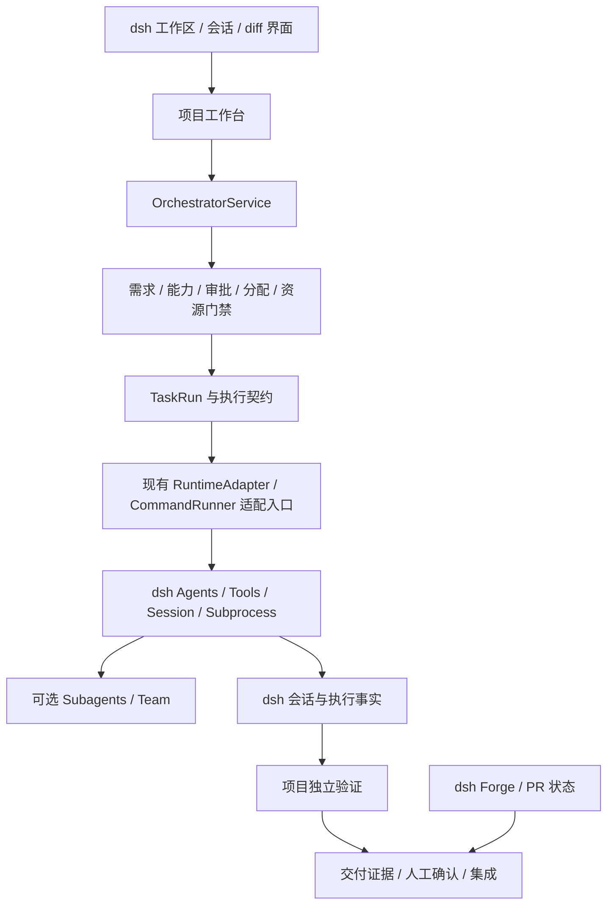

# dsh 原生能力接入与最佳实践方案

日期：2026-11-09。状态：用户已授权按方案实施，实际完成范围与验证见[实施验收记录](dsh-native-integration-implementation-2026-11-09.zh-CN.md)。设计基线：官方 `@deepseek-ai/dsh@0.2.2-rc.1` 发布包的 README、公开类型与实现，以及本项目当前工作区。截图仅证明界面展示了相关入口与开关，不证明这些能力已在本项目运行。

## 1. 结论与目标

可以结合，而且应继续复用 dsh 的运行基础。建议的职责划分是：dsh 管 Agent、模型、会话、工具、执行环境和通用交互；本项目管需求、可信成员能力、计划审批、任务依赖、验收和最终交付。

本项目已经在使用 dsh，并非完全独立的另一套 Agent 系统。本次版本适配已迁移会话查询、预设注册、工作区导航和 UI 依赖，详细证据见[适配验收记录](dsh-0.2.2-adaptation-2026-11-09.zh-CN.md)。本文讨论进一步接入截图能力的做法，不表示已启用团队、自动审查、定时执行或 GitHub 写操作。

目标是减少执行基础设施重复建设，同时保留现有业务门禁和可追溯交付。当前不扩展到跨机器调度，不迁移真实历史数据，不自动开启实验插件，不发布、合并 PR 或创建付费模型任务。

## 2. 已有能力与接入选择

| dsh 能力 | 本项目当前事实 | 建议与优先级 |
|---|---|---|
| Agent 循环、模型路由 | `runAgent` 已通过 `ctx.agents.create` 创建 Agent，挂载预设、Persona 与工具 guard | 继续复用；项目保留总超时、业务取消和预算约束，P0 |
| 会话、流式响应与持久化 | 已使用 `sessions.flush`、`sessionQuery.readSession` 和 TaskRun 转录 | 会话日志归 dsh；验收证据归本项目，P0 |
| 工作区与导航 | `workspaces.create`、`uiWorkspace.startSession` 已接入 | 复用原生选择、目录浏览、会话导航，不维护第二套工作区身份，P0 |
| Skills | 已依赖 `ctx.skills`，Agent 可配置技能名称 | 增加所需技能及工具的可用性诊断；Skill 名称不能证明成员有业务能力，P0 |
| 子智能体 | 本项目运行多个独立 Agent，未见对 `ctx.subagents` 的直接接入 | 先用于任务内只读调研或评审；不默认替换 TaskRun，P1 |
| 智能体团队 | 本项目已有 Squad、Delegation、Issue、Task 和分配规则 | 可做一次 TaskRun 内的受控协作试点；禁止两套任务板同时推进项目状态，P2 |
| 终端与进程 | 模型工具由预设提供；服务端验证命令仍由本项目 `CommandRunner` 启动 | 优先评估 `ctx.subprocess` 接管进程生命周期；PTY 只用于交互命令，P1 |
| 自动授权审查 | 项目已有计划批准、可信能力和资源授权；未直接依赖 Auto review | 作为可选工具操作审查，不能代签项目批准和人工能力声明，P2 |
| PR 与变更展示 | 本项目自行保留 Git 与交付证据；未直接依赖 `ctx.forge` | 优先复用 PR 状态、检查、diff 展示，默认只读，P1 |
| 工作树 | 已有 TaskRun worktree、目录锁、lease 和 canonical integration | 保留现有生命周期；原生 worktree 服务先仅用于交互辅助，P2 |
| 网页搜索 | 预设提供的工具仍受项目 guard 控制；冻结规划阶段禁止工具执行 | 允许需求研究阶段受控使用；结果需转成显式来源，不能充当本地代码证据，P1 |
| 自动化任务 | 项目有执行与审计内部计时器，未接入 `ctx.schedule` | 先做只读状态提醒；不把内部 heartbeat、补偿计时器迁成模型提醒，P2 |
| 语音输入 | 项目支持文本和文件需求输入，未直接接入语音服务 | 优先使用 dsh 输入能力；转录后用户审阅，保存前不触发规划，P3 |
| 自定义插件索引 | 本项目是 dsh 插件，尚未新增市场索引集成 | 属于分发和安装能力；核心交付流程不依赖它，P3 |

P0 是当前基础适配与运行诊断；P1 优先实施；P2 需要独立试点；P3 不作为本期验收前置。表中的接入建议均不改变已授权范围。

## 3. 状态与责任边界

| 事实 | 权威写入方 | 另一侧允许做什么 |
|---|---|---|
| 会话、模型请求、工具结果、Agent inbox | dsh | 本项目按 Session 身份读取并保留所需证据 |
| 原始需求、业务 Decision、任务依赖和计划版本 | 本项目 | dsh 获得冻结的任务输入，不得自行改审批事实 |
| 项目成员、`human_confirmed` 能力、资源授权 | 本项目及其正式确认入口 | dsh roster、Persona 和 Skill 仅作为运行信息 |
| Team 内部任务和消息 | dsh Team | 本项目只映射到父 TaskRun，不双向镜像整个项目任务板 |
| worktree lease、目录锁、最终集成目标 | 当前项目执行与交付服务 | 原生服务需要通过适配契约才能替代其操作部分 |
| GitHub PR head、checks 与远端审阅状态 | GitHub，经 Forge 读取 | 本项目保存带 head 和采集时间的快照，并应用本地交付规则 |
| 验证结论和交付批准 | 本项目验证器与正式人工入口 | Agent 完成文本、Team completed、PR 绿色均不能直接代替 |

有效执行权限必须同时满足项目业务门禁、工具 guard、dsh 操作权限与实际执行环境限制。`ctx.authorization` 是凭据获取流程服务，不是项目操作审批 API，不能因名称相近误用。

## 4. 重点接入设计

### 4.1 进程与验证：先统一执行基础

相关位置：`src/execution/command-runner.ts`、`src/execution/git-command.ts`、`src/verification/service.ts`、`src/verification/browser.ts` 和 `src/service.ts`。

当前 `CommandRunner` 直接调用 Node `spawn`，因此不会因为用户在 dsh 页面修改终端配置就自动获得相同的超时、权限或沙箱行为。这是优先处理的实际集成缺口。

实施建议：保持 `CommandInvocation`、`CommandResult` 与上层验证契约，增加使用 `ctx.subprocess` 的执行实现，逐个替换明确的调用入口。命令 argv、cwd、环境覆盖、输出字节上限、退出事实、取消和等待进程真正结束都要显式传递。保留项目 `.venv` 解析和测试命令来源校验。`subprocess` 仅提供进程基础，沙箱策略需通过配套执行 provider 接线并验证，不能把换了 API 当作已获得沙箱。

交互式 PTY 使用 `ctx.terminals`，适合需要持续输入的命令；非交互测试仍使用一次性进程，避免提示符、控制字符和输入等待污染验收证据。现有 CLI/无 Host 场景需显式选择本地实现；Host 缺失所需能力时应报告不可用，不能在受限模式下偷偷回退直接 spawn。

验收：成功、非零退出、无可执行文件、预先取消、运行中取消、超时、输出截断、子进程清理、`.venv`、只读模式拒绝写入，以及受限模式不隐式回退。测试失败继续记为验证失败。

### 4.2 PR 与 diff：复用读取，保留交付判断

新版存在 `ctx.forge.watch`、`fetchChecks`、diff 与文件读取接口，GitHub provider 通过 Host 已登录的 `gh` 工作。先增加可选 PR 绑定，保存 provider、规范化 URL、repository、PR 编号、headCommit 和采集时间；由 Forge 提供共享轮询，本项目不再为同一 PR 新建重复轮询。

首期只读展示 PR 状态、检查、审阅意见和 diff。检查不完整、限流、无登录、不可访问和数据过期都需明确呈现。只有证据 head 与本次交付 head 一致，才能参与交付预检；Forge 的 `mergeReady` 不是本项目“允许交付”的同义词。

`workspaceChanges` 的摘要和比较仅在当前 Host/Session 生命周期内可用，且不覆盖所有子智能体或 shell 修改。它适合 UI 浏览，不能替代现有持久 Git diff、commit 和验收摘要。

后续如加入发布审阅、标记 ready 或 merge，单独设计操作确认和失败恢复。远端写入超时可能结果未知，不自动重试写操作；merge 必须绑定用户确认的精确 head。

验收：未安装 Forge 时主流程可用；缺 `gh`、登录失败、head 改变、checks 分页或截断、限流、重启重建 watcher；旧 head 的绿色检查不能通过新交付。

### 4.3 子智能体与 Team：限定在任务执行内部

dsh 子智能体管理提供父子关系、容量、消息、冷恢复与资源释放；本项目继续拥有跨任务的依赖、分配、可信能力与验收。两者处于不同层级，不应全量互换。

先做子智能体只读试点：一个已批准的 TaskRun 内启动研究或评审子任务，记录父 TaskRun、root Session、child Session 和执行契约摘要。派发前验证工具范围、模型路由、取消传播、并发与总预算。继承和限制的实际行为需要测试，不能只靠 Persona 约束。子任务完成仅表示执行结束，输出仍由项目校验。

Team 进一步提供具名成员、点对点消息、持久 roster 和共享 CAS 任务板，但官方明确其成员共享 cwd，写范围只是提醒，不能阻止冲突；任务拥有者不会因中断或退出自动释放。其只支持单进程共享 checkout，不能直接替代本项目的 worktree 隔离和 lease。

因此 Team 首期只用于单个 TaskRun 的只读协作，不在同一目录让多个成员并行写。成员必须映射到已有合格项目成员；Team 创建成功不产生任何 `human_confirmed` 能力。跨 TaskRun 的执行仍由原调度器控制。试点通过后，再评估是否逐步收敛自建 Delegation 的运行部分，审批和验收模型保持归属清晰。

验收：无能力成员拒绝、伪造成员名拒绝、容量耗尽、中途取消、子任务失败、Host 重启、迟到结果、重复消息、Team CAS 冲突、父任务终态后的输出；不新增项目任务、不扩工具权限、不自动通过验收。

### 4.4 自动授权审查：可选且不能提升业务权限

Auto review 在支持的工具调用前使用当前 Agent 的模型审查，允许时以 Full access 执行，拒绝时请求用户或按当前 approval policy 拒绝。它会额外消耗模型 token，分类可能错误，也不提供文件沙箱；PTC 内直接 Node 副作用不等价于被逐个内部工具审查。

建议保持实验开关默认关闭，由用户在独立试点会话选择；不把某次允许写入转成项目批准、成员能力声明、资源永久授权或发布批准。本项目已有 `tools.guard` 在共享流水线中形成拒绝约束，必须验证 Auto allow 后该 guard 仍能拒绝任务范围之外的调用。

新增服务端命令路径还需单独接入操作策略；不能声称 Auto review 会审查所有 Node `spawn`。审查失败、工具拒绝和待人工处理应分别记录，禁止不断换工具重试直到获准。总预算要覆盖审查请求，而不只统计主 Agent 回复。

验收：Auto allow 仍受项目 guard 约束；拒绝后工具执行次数为 0；模型错误可见；PTC 与直接进程路径分别验证；缺插件时不给出虚假可用状态。

### 4.5 worktree：先保留现有执行所有权

原生 `ctx.worktrees.create(agent, ...)` 创建并进入新的工作树，默认基于本地 HEAD，且不复制未提交修改；离开后保留目录与分支。其默认池、保留策略和 cwd 切换，与本项目 TaskRun 的分支、锁、回收和 canonical integration 不同。

不直接将 `claimWorkspace` 或交付集成替换成原生调用。先允许用户通过原生 UI 检查关联 checkout；如后续确需统一创建操作，须为现有执行适配器补齐以下契约：固定 baseCommit、创建意图、目录锁、lease、部分创建失败、重启发现、保留/归档策略和清理所有权。两侧不得同时删除或重建同一路径。

验收：已有目录拒绝、基线不一致、未提交修改保留、失败遗留可发现、取消后锁释放、重启恢复、并发竞争、dirty canonical target 拒绝集成。恢复不许丢弃用户或其他任务改动。

### 4.6 搜索、自动化、语音与插件索引

搜索仅在用户允许联网的研究入口开放，并记录 URL、采集时间和对应需求；搜索文字是外部内容，不能升级成工具指令。当前冻结规划 Agent 禁止工具执行，接入搜索应增加独立研究阶段，而非整体放宽该 guard。DeepSeek 搜索 provider 有独立 endpoint 和凭据要求，不能假定现有对话网关自动支持它；接入时先做能力诊断，不读取或展示密钥。

`ctx.schedule` 是持久提醒和会话投递服务，首期可用于项目状态检查提醒。投递被持久化确认不代表项目作业完成。不得用自由文本定时消息直接调用发布或跳过审批。业务触发需要单独保存 projectId、触发身份、occurrence/幂等键和授权上下文；重复或迟到触发仍重新检查计划版本。内部执行 heartbeat、锁续期和补偿继续由现有确定性流程管理。

语音先借助原生输入转成文本，再经现有需求表单审阅；转录结果不直接开工。插件索引用于发现和分发，安装与启用仍通过 dsh 正式流程；不为使用本插件要求用户开启所有实验能力。

## 5. 分阶段落地与修改位置

| 阶段 | 交付物 | 主要位置 | 完成条件 |
|---|---|---|---|
| A：基础适配 | rc.1 接口、Node 24、真实 Host 验证、原生工作区导航 | `package.json`、`src/index.ts`、`src/client.tsx`、`src/service.ts` | 见本轮适配记录；与完整发布验收分别报告 |
| B：只读集成 | Host 能力诊断、PR 绑定与状态、Session 导航、证据引用 | `src/query/service.ts`、`src/http.ts`、`src/api-client.ts`、`src/client.tsx`；新增可选 forge adapter | 插件缺失、认证失败、旧 head 和重启均有验证；不开启远端写操作 |
| C：执行基础 | subprocess 执行实现、执行环境与取消一致性 | `src/execution/command-runner.ts`、`src/execution/git-command.ts`、`src/verification/service.ts`、`src/index.ts` | 前述命令及权限矩阵通过，CLI 与 Host 行为边界明确 |
| D：协作试点 | 任务内只读 subagent；通过后单独评估 Team | `src/execution/runtime-adapter.ts`、`src/execution/broker.ts`、`src/service.ts`；新增可选协作 adapter | 父子身份、取消、重启、权限、预算、失败与独立验证均通过 |
| E：可选体验 | Auto review、提醒、语音、索引入口 | 独立可选插件集成与工作台入口 | 每个开关分别验收，不成为核心包加载前提 |

不一次性增加大量 adapter 抽象。优先复用现有 RuntimeAdapter、CommandRunner 与 query 层；当具体服务确需隔离时才增加对应文件。可选集成单独注册 Cordis 依赖，避免把实验服务加入核心必需 `inject` 导致未启用用户整个插件无法启动。检测实际服务和 provider readiness，不靠“npm 包已安装”判断可用。

只读 PR 快照或外部执行关联如需新增持久表，应有明确 Schema 版本和向后兼容读取；不重写旧 TaskRun、审批或能力事实。迁移先做副本演练，新旧版本共存和回滚路径需单独验证。模型调用、搜索调用、Auto review 和子任务预算统一归属父 operation，禁止各自无限重试。

## 6. 架构决策记录

### ADR-01：保留项目业务状态所有权

状态：建议。采用 dsh 基础运行能力，本项目继续拥有审批、能力、计划和交付。理由是原生 Team 的 task completed 与项目 Acceptance verified 语义不同。放弃“将 Team 任务板直接替代项目任务表”的方案，避免审批、独立验证和恢复证据丢失。代价是需要保留少量显式身份映射。

### ADR-02：实验能力按需接入

状态：建议。Forge、Team、Auto review、worktree 等可选能力隔离接入，缺失时明确不可用。放弃所有实验依赖全部设为核心必需的方案，保留小型安装与 CLI 的可用性。代价是测试需要同时覆盖能力存在、缺失和 provider 不可用。

### ADR-03：优先统一进程执行，再引入自动协作

状态：建议。先验证 `subprocess`、命令证据、权限和取消，再试点子智能体。放弃先增加更多并行 Agent 的方案，因为当前直接 spawn 路径与原生工具策略不是同一条执行链。代价是协作体验延后，但可先建立能够复用的执行与验收基础。

### ADR-04：工具审查与业务批准分别记录

状态：建议。Auto review 的操作允许、项目计划批准、能力确认、最终交付确认分别保持原有语义。放弃用模型审查批量代填人工事实的方案。代价是界面需展示不同批准对象，但可避免把对一次工具调用的许可误用为整个项目授权。

## 7. 验收与发布边界

本方案的设计验收：截图每项能力均有当前事实、接入建议、状态归属和失败边界；P1 有实际修改入口及可验证条件。用户已明确要求按方案落地；该授权不等于自动开启真实 Host 的可选实验开关。实际完成状态以实施验收记录为准。

实施验收分为四层：类型与构建；隔离单元/集成与权限失败用例；真实 rc.1 Host 的生命周期和 UI 检查；涉及模型质量或成本的能力另做真实模型对照。确定性 adapter 结果不得冒充真实模型评测。

只有选定阶段的所有必要条件通过才能宣称该阶段可用。整个项目正式可交付还需现有完整发布门禁通过，本方案及本轮版本兼容检查不改变其未完成项。升级真实 Host 前备份整个 DSH_HOME 和旧程序；Schema 或 Host 写入格式发生变化时，回滚须恢复匹配的程序与数据快照。

## 8. 核验来源

以本次实际安装的 `0.2.2-rc.1` 发布包类型和 README 为接口依据；以下官方仓库链接便于进一步阅读，`master` 会变化，实施时继续核对所锁版本：

- [官方 dsh npm 发布入口](https://www.npmjs.com/package/%40deepseek-ai/dsh)：当前版本与启动、Profile 入口。
- [Agent Team](https://github.com/deepseek-ai/deepseek-harness/blob/master/packages/experimental/agent-team/README.md)：共享 cwd、CAS、写范围提示及生命周期限制。
- [Auto review](https://github.com/deepseek-ai/deepseek-harness/blob/master/packages/experimental/auto-review/README.md)：模型操作审查、成本与权限边界。
- [Worktree](https://github.com/deepseek-ai/deepseek-harness/blob/master/packages/experimental/worktree/README.md)：创建、恢复、保留策略及文件策略。
- [GitHub Forge provider](https://github.com/deepseek-ai/deepseek-harness/blob/master/packages/experimental/forge-github/README.md)：Host gh、检查、精确 head 和未知写入结果。
- 本项目依据：`src/index.ts`、`src/service.ts` 的 `runAgent` / `claimWorkspace`、`src/client.tsx`、`src/execution/runtime-adapter.ts`、`src/execution/command-runner.ts`、`src/verification/service.ts`、`src/delivery/service.ts`。
