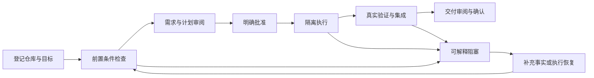

# 项目改进方案：从工程契约完整走向真实交付可用

> 分析日期：2026-09-22
>
> 基线：`dsh-project-orchestrator@1.7.0`，Git `726e728`
>
> 文档性质：基于上述 Git 基线的现状分析、改进路线、实施顺序与验收标准。工作区中的未提交实现不自动视为完成证据；真实模型调用、认证 Host、部署与发布结果必须单独记录。
>
> 配套落地设计：[项目改进技术设计：验证闭环、规划评测与可靠恢复](project-improvement-technical-design-2026-09-22.zh-CN.md)
>
> 2026-10-17 执行状态：[真实验收记录](project-acceptance-2026-10-16.zh-CN.md)。204+52 项发布评测能力已正式登记；greeting 最终交付已批准并导出真实 V2 canary。v30 正式门禁未通过，v31 正在修复冻结证据与诊断契约并验证，尚未取得新版本发布资格。下文原基线分析和历史验证不得替代当前正式门禁结论。
>
> 阅读说明：第 2 节保留方案建立时的基线诊断，第 4 至 10 节描述目标方案，第 11 节记录当前工作区的实施与验证状态。判断“现在是否完成”时以第 11 节为准。

> 2026-10-16T15:13Z：当前结果见[最新验收报告](project-acceptance-2026-10-16.zh-CN.md)。256 项能力已登记。v29 已完整自然收口，4 条有效候选中 3 条达标、Ky 1 条质量失败，0 模型失败；正式 gate 退出 1。v30 修复代码闭包挤占命令及编译配置证据的问题，保持 64/96 KB 总预算和所有质量门槛不变。压力回归修前失败，修后完整验证退出 0（522 Node、6 browser 等）；七项关键声明、package.json 和三个 tsconfig 的完整性均已核实。新包隔离安装、256 项能力、V2 canary 及 20 组历史证据复核通过；25 项 Gold 已启动独立审阅，真实诊断的修后输入 ready，其余对照仍在途。诊断不计正式候选，整体验收仍未通过。

> 2026-10-14 更新：[最新验收记录与剩余实施方案](project-acceptance-2026-10-14.zh-CN.md)。真实模型授权已取得，模型连接已恢复；最新运行结果以该记录为准。

## 1. 核心判断

项目最值得做好的方向是：**帮助本机开发者把一份真实需求，稳定地变成经过审批、可以执行、能够验收、失败后可以恢复的仓库变更。**

当前已经有较完整的领域模型、Planning V3、审批摘要、任务分派、worktree、执行租约、Git 集成和交付收敛机制。下一阶段的主要工作应是补齐真实验证、减少误阻塞、打通恢复路径，并让用户容易完成第一条交付。

建议按以下顺序投入：

1. **先证明能用**：实际工作台 E2E、真实模型评测、一次完整 Source-to-Convergence canary。
2. **再证明可靠**：验证证据必须对应真实场景；错误阻塞可测量；部分写入有可操作的恢复流程。
3. **再降低使用成本**：检查前置条件、解释阻塞、明确下一步、缩短人工配置与审批时间。
4. **最后扩大规模和覆盖面**：按热点拆服务，优化读取与索引，再根据真实需求增加语言栈。

当前适合定位为有严格门禁的本地编排工作台。现有证据不足以认定“跨仓库稳定好用”，也不足以满足仓库自身的正式发布资格。

## 2. 现状与证据

### 2.1 已有能力应保留并继续使用

| 领域 | 当前已有实现 | 下一步的正确起点 |
| --- | --- | --- |
| 产品边界 | 本地优先、嵌入 Harness、空项目与 AI 拆解分离 | 聚焦单 Host、单仓库的常见交付流程 |
| 需求与规划 | Requirement、Acceptance、Decision、Scenario、Binding、Task、Preflight 等结构化事实 | 用真实样本验证识别质量和规划可执行性 |
| 执行授权 | Revision/hash 审批，能力和访问校验，分派契约 | 保留审批失效、过期拒绝和权限边界 |
| 仓库规则 | 已有 selector、适用性判定和 `needs_confirmation` | 校准误判，不能再把旧版“规则全部适用”当现状 |
| 仓库检索 | 已有需求关键词排序、依赖扩展和检索报告 | 完善语义关系、预算和大型仓库覆盖 |
| 执行可靠性 | ExecutionBroker 已接入 TaskRun，支持 claim、heartbeat、租约和重启处理 | 补齐执行适配器接入与真实故障场景 |
| 规划恢复 | checkpoint、write-ahead intent、恢复检查与 successor | 补齐不确定写入的 reconciliation 操作闭环 |
| 前端刷新 | 事件游标触发快照刷新，并有周期性全量兜底 | 优化全量投影和按需读取，而非重新建设事件 API |
| 发布工程 | Ubuntu/macOS CI、包检查、版本校验、正式规划门禁 | 补真实发布证据，不降低现有门禁 |

已有[工程优化方案](evidence-grounded-task-planning-engineering-optimization-plan.zh-CN.md)第 15 节记录了部分实施进度。本文件基于最新代码重新核实，重点处理仍未闭环的部分；旧文档前部的历史诊断不应直接作为当前缺陷清单。

### 2.2 方案建立时的实际验证（历史基线）

本节记录首次分析基线，不代表当前工作区状态。后续实现与最新回归结果见第 11 节。

运行环境：macOS，本机 Node.js `v22.22.3`、pnpm `10.34.5`。

| 检查 | 实际结果 | 可以说明什么 |
| --- | --- | --- |
| `pnpm verify` 中的 typecheck | 通过 | 当前 TypeScript 类型检查通过 |
| `pnpm verify` 中的 docs:check | 通过 | 修改前 49 个 Markdown 文件的文档检查通过 |
| `pnpm verify` 中的 build 与 Node tests | 构建通过，346/346 测试通过，无跳过 | 现有自动化契约与回归用例通过 |
| `pnpm verify` 中的 test:browser | 浏览器启动失败 | 本机缺少 Playwright 要求的 Chromium headless shell，未执行到页面断言 |
| 单独运行 `pnpm eval:planning:subset` | 5/5 冻结样例通过 | 评分器可以处理当前 fixture，不能证明模型效果 |
| 单独运行 `pnpm eval:planning` | 退出码 1，发布资格失败 | 仅 1/8 仓库、1/24 独立需求样本、0/5 真实模型运行，且缺少 release canary |
| 单独运行 `pnpm smoke:package` | 通过，产物包含 110 个文件 | 修改前的包内容、临时安装和 CLI 冒烟通过 |

`pnpm verify` 总体未通过，浏览器环境缺失是此次中断原因；后续 subset 和 package smoke 是单独补跑的。未下载浏览器、未运行付费模型、未连接用户真实 Harness 数据，也未获取本次提交的远程 CI 结果。

### 2.3 主要发现及定位

| 编号 | 证据与发现 | 对项目的影响 |
| --- | --- | --- |
| E01 | [发布评测入口](../planning-evals/run.mjs)、[样本目录](../planning-evals/cases/large-typescript-owner/gold.json)：当前只有一个 fixture case，正式门禁要求至少 8 仓库、24 case、每 case 至少 5 次真实模型运行及 canary | 发布资格尚未闭合；不能把 fixture 满分解释为可用性达标 |
| E02 | 基线文件 `tests/browser/planning-evidence.spec.mjs`：测试自行创建 HTTP 服务、JSON 文件和内联 HTML，未加载实际 `client.tsx`、`OrchestratorService`、`OrchestratorStore`；该文件已在后续工作区改造中被替换，因此不再提供失效的本地链接 | 能验证示例页面，不能保护真实工作台的关键交互 |
| E03 | [BrowserVerificationProvider](../src/verification/browser.ts#L68)：检查 manifest 和命令关键词后，主要按进程退出码判定；[执行入口](../src/service.ts#L10401)仍使用通用 `runCommand` | 浏览器能力的声明、实际执行、场景结果之间尚缺强关联 |
| E04 | [评分器](../planning-evals/grader.mjs#L41)：有 false-ready 和分派弃权指标，但没有 Gold 期望 readiness 与错误阻塞指标 | 可能奖励“结构正确却始终 blocked”的规划，不能同时衡量安全与可用 |
| E05 | [UnitOfWork](../src/storage-unit-of-work.ts#L54)、[恢复逻辑](../src/service.ts#L7519)、[管理 API](../src/http.ts#L26)：可以记录并查询不确定写入，未发现对应的预检、修复、复核命令闭环 | 遇到 `needs_reconciliation` 后仍可能需要维护者手工处理 |
| E06 | [主服务](../src/service.ts#L1101)共 12,339 行，[types.ts](../src/types.ts)3,975 行，[client.tsx](../src/client.tsx)2,748 行；`planning/coordinator.ts` 当前主要是 checkpoint 辅助函数 | 规划、执行、恢复和 Prompt 组装仍高度耦合，变更影响难控制 |
| E07 | [刷新实现](../src/client.tsx#L440)、[事件读取](../src/storage.ts#L564)、[快照投影](../src/storage.ts#L578)：事件出现后仍刷新全量 snapshot；事件读取全量排序，snapshot 包含历史运行与大量规划记录 | 随历史数据增长存在放大开销；目前未做负载实测，不能宣称已经出现性能事故 |
| E08 | [检索实现](../src/planning/repository-evidence.ts#L118)、[语义解析](../src/planning/repository-stack-profile.ts#L10)：检索已有改进，但仍主要依赖词法评分、相对 import 扩展；脚本解析超过 2,000 文件会返回 partial | “检索不再按路径截前 2,000 项”不等于“大型仓库已完整支持” |
| E09 | [Provider 支持矩阵](../src/planning/providers/index.ts#L132)：Java/Python/Go 明确 unsupported；[快速开始](quickstart.zh-CN.md)未完整解释 V3 的支持条件、能力确认和访问前置条件 | 用户可能在规划完成前后才遇到本可提前告知的阻塞 |
| E10 | [Host 验收脚本](../scripts/verify-host-acceptance.mjs#L74)把 `corruptionFailureObserved: true` 与 `corruptBytes: 37` 固定写入报告 | 当前脚本执行本身不能证明报告声称的破坏/恢复实验发生过；应绑定独立证据或实际执行记录 |

现有 `InlineRuntimeAdapter` 和 `BrowserVerificationProvider` 均有导出与独立测试，但检索生产调用点后，未发现二者已成为 Service 主执行路径。这里区分“类已存在”和“产品已使用”，不把它们列为完全缺失的组件。

## 3. 产品目标与使用边界

### 3.1 先服务两种高频任务

首批重点场景：

- **已有仓库的小型缺陷修复**：用户给出复现现象，系统找到归属代码、补回归验证、实施、展示交付证据。
- **边界清楚的小型功能**：用户给出结果与约束，系统拆出必要实现和验证任务，处理依赖并完成集成。

空项目、手工任务和上下文管理继续保留。首次使用无需先理解全部 Squad、Runtime、Capability、Policy、Checkpoint 概念。

建议下一阶段优先覆盖当前有解析能力的 TS/JS 仓库及已声明的 Vue/Nuxt/Prisma 组合。每个支持声明都要带文件规模、语义能力、命令和测试前提。Java/Python/Go 可以登记项目、使用相应已有通用能力，但不能据此宣称 V3 自动规划已获得语义支持。

### 3.2 用户完成一次交付的标准

成功必须满足：原始需求与验收未丢失，计划明确，执行范围受控，验证对应实际结果，最终 Git 产物可查看，失败可恢复。TaskRun 完成、测试命令退出 0、集成完成和项目交付确认应分别表达。

## 4. P0：先补齐可用性与验收证据

这里的 P0 指下一阶段交付的阻断项，并不意味着已发现线上事故。

### P0-1：建立真实工作台 E2E

**修改位置**：`tests/browser/`、`playwright.config.mjs`、测试 Host 启动脚本；必要时为实际客户端提供最小 Harness 容器。

实施方式：

1. 启动使用临时数据目录的测试 Host，加载真实插件 bundle、HTTP handler、Service 和存储。
2. 模型边界使用确定性替身以保证 PR 回归稳定；真实模型效果由独立评测验证。不能同时替换业务 Service、存储和实际页面。
3. 通过实际按钮与表单操作，并在存储、API、DOM 三层比对同一 Project/Operation/TaskRun ID。
4. 保留现有示例测试作为基础设施自检，新增产品链路测试，避免把示例断言数量当产品覆盖率。
5. 本地指南写清 `pnpm exec playwright install chromium`；Linux CI 保留现有 `--with-deps` 安装流程。

首批必须覆盖：

| 场景 | 核心断言 |
| --- | --- |
| 创建空项目 | Project 持久化；Planner 调用、Approval、Dispatch、TaskRun 均为零 |
| 明确发起 AI 规划 | 显示真实阶段与结果；审批前没有仓库修改或执行 |
| 需求决策或能力不足 | 展示具体原因与修复入口，按钮状态与服务端门禁一致 |
| 计划发生变更 | 旧 revision/hash 审批被拒绝，页面刷新后不保留虚假可执行态 |
| 批准、执行、验证失败 | TaskRun 失败证据可见，不能显示为交付完成 |
| 断线与恢复 | 刷新、Host 重启、请求返回乱序后状态仍与持久化事实一致 |
| 实际交付审阅 | 最终 commit、验证证据、Convergence 和人工确认关联同一计划 |
| 键盘与窄屏 | 关键操作可键盘完成，焦点可恢复，状态不只依赖颜色 |

**退出条件**：实际 UI→API→Service→Storage 链路在桌面与窄屏通过；直接断言取消、重复点击、过期审批的副作用数量。截图是辅助证据，不能替代状态断言。

### P0-2：让浏览器验证结果具备场景级证明

本次做了一个不启动浏览器的最小实验：调用现有 Provider，运行仅输出 `browser test marker; no browser launched` 的 Node 命令。结果为 `status: passed`、`exitCode: 0`、`artifacts: []`。

这证明该 Provider 目前只足以表达“命令执行成功”。它还不足以独立证明声明的浏览器场景通过。由于 Service 当前未调用它，本实验**不等于**已经证明产品发生了 false-converged。

改进设计：

- 复用现有受控命令执行、环境过滤、取消和超时能力，避免建立两套行为不同的进程管理。
- Browser verification 使用固定版本的 runner adapter，解析结构化 reporter 结果，关联明确的测试 ID 与 Scenario ID。
- 结果绑定当前 `TaskRun`、`PlanSnapshot`、仓库 commit、命令摘要与本次 invocation ID。
- required 场景不存在、全部 skipped、零测试、报告过期或缺失时，必须失败或明确 unavailable。
- 按场景保存断言结果与必要产物；图片和 trace 文件存在本身不代表验收通过。
- 实际执行链按验证类型调用对应 provider，再落盘 `VerificationEvidence`，由 Integration/Convergence 消费。

**退出条件**：成功路径使用真实浏览器；打印伪成功文本、只跑构建、复用旧报告、遗漏 required 场景、缺少浏览器均不能生成通过证据。

### P0-3：同时评价错误放行与错误阻塞

当前 grader 的优势是严格检查需求、验收、owner 和分派；不足是没有独立定义“这个输入应当 ready 还是 blocked”。

本次在内存中调整既有样例，为所有任务提供 Gold 认可的合格 Agent，保留完整需求与证据，但仍令候选 `status: blocked`。对五条诊断输入评分后，aggregate 依然 `passed: true`。未修改或保存评测样本，也未通过真实模型 provenance 或完整发布门禁。

建议扩展 Gold 与 grader：

- `expectedReadiness`：`ready`、`blocked` 或带明确条件的允许集合。
- `expectedBlockingReasons`：按稳定原因码和关联事实记录，避免只比较自由文本。
- 新增 false-blocked、首次可批准率、阻塞原因正确率；继续保留 false-ready=0 等现有硬门禁。
- 增加同一需求的“事实不足应阻塞→补齐事实应恢复”成对样例，防止一律拒绝策略获得高分。
- 需求 key 覆盖之外，人工 Gold 审查语义是否改变、任务边界是否合理、验证是否真正有意义。
- 人工改写结论由评测者独立标注并留下依据，不由 Planner 自评。

**退出条件**：错误放行、错误拒绝、忽略负面约束、错绑 owner、虚构能力、变更原始验收的变异样例均被检出。新增指标先建立真实基线，再经评审冻结阈值；不随失败样本临时放宽。

### P0-4：完成真实评测 corpus 与 canary

已有格式、grader、导出 API 和 CLI 应直接使用，优先补数据与执行闭环。

1. 选择至少 8 个合法可用、身份不同的仓库，覆盖当前声明支持的主要组合与规模。
2. 每仓库至少准备 3 个独立审阅需求，构成至少 24 个 case；同一需求的多条 Requirement 不重复计数。
3. 分布覆盖修 bug、新增功能、只读修改、UI+API、异步失败、冲突规则、大型仓库 owner、能力不足等场景。暂不支持的主栈作为正确拒绝用例。
4. 冻结 base commit、需求输入、团队、Decision、Prompt/MetricPolicy、模型版本和预算，每 case 至少 5 次真实模型运行。
5. 通过已有 `capture-planning-eval` 命令采集；真实运行与 fixture 分库存放或明确过滤，但不能将 fixture 改标签充数。
6. 在授权的临时仓库跑一次完整交付，采集与当前包版本绑定的 `capture-release-canary` 证据。
7. 真实效果比较采用相同冻结输入和配置，并区分开发集与保留评测集，降低为个别 case 增加特判的风险。

最低规模为 **120 次真实规划 operation，加一次完整交付 canary**。预算应先用少量样本估算，再决定批次；执行这部分涉及模型成本和样本内容，属于后续实施安排，本次未启动。

**退出条件**：现有正式 `pnpm eval:planning` 通过，并且新增 readiness 指标达到已冻结阈值；每一条结论可追溯到独立 operation 和人工 Gold。

## 5. P1：让失败可恢复、流程可理解、代码可维护

### P1-1：补齐 reconciliation 操作闭环

现状已有 fail closed、intent 查询和恢复检查，应在此基础上增加可验证的恢复流程。不能直接把状态从 `needs_reconciliation` 改成 `committed`。

建议由存储协调层提供两个阶段：

1. **只读预检**：检查 intent 的预期写入、当前记录、摘要、权威 Project 指针与相关副作用，返回 `replay_safe`、`compensation_safe` 或 `manual_required`。
2. **执行恢复**：接收精确 intent ID、预检摘要、当前 revision 和幂等键，重新校验后执行；保留恢复前后证据，结果重新验证后才允许业务续作。

为需要重建的步骤保存可解析的 record ref、预期内容摘要与必要的前置摘要。当前 intent 的步骤描述不包含可重建写入内容，不能假设只根据闭包列表就能跨进程重放。

逐条纳入高价值写入边界：计划发布、分派、TaskRun 终态、Integration 与 Convergence。先覆盖最关键的一条链路，不一次性替换所有 `put()`。

测试矩阵必须包含：写前失败、写后但进度落盘前崩溃、event 写失败、补偿失败、重复恢复请求、过期恢复请求、真实进程终止及重启。

**退出条件**：注入部分写失败后，可通过产品/CLI 查看原因、预览恢复并安全收敛；不依赖直接编辑 JSON。状态不确定时仍阻止相关执行。

### P1-2：把首次使用与阻塞处理变成一条清晰路径

沿用 `PRODUCT.md` 与 `DESIGN.md` 的克制工程工具风格、Harness token 和现有交互组件。优先改信息层级和操作路径，暂不重做视觉主题。

建议 Project 概览默认回答四个问题：

- 当前在什么阶段，最近一次动作是否成功？
- 用户现在需要处理什么？
- 哪些事实阻止了继续？
- 可以在哪里查看需求、变更和验证证据？

具体设计：

| 触点 | 建议行为 | 验收方式 |
| --- | --- | --- |
| 规划前 | 显示仓库栈、规模、命令、模型配置、项目成员/能力、访问范围的准备情况 | unsupported 或缺前置条件时，用户在昂贵规划前即可获知 |
| 首次组队 | 默认 Host 与已有角色模板提供可复核的设置入口；能力仍由真实授权或证据确认 | 不能从名称、Persona、Skill 文案直接获得受信能力 |
| 阻塞详情 | 显示中文原因、关联需求、缺失事实和一个明确下一步；技术诊断折叠 | 无需复制 error code 去猜操作 |
| 计划修订 | 展示新增、删除、变更的需求/任务、受影响审批与预计重跑阶段 | 用户确认的是具体差异，不是模糊“重新规划” |
| 执行页 | 显示当前任务、依赖等待、队列/租约、验证和可取消状态 | 区分等待资源、执行失败和需要人工决策 |
| 交付页 | 区分任务通过、集成完成、收敛审阅、人工确认，展示最终 Git 产物 | 不用单一绿色 completed 掩盖尚未完成的交付环节 |

先使用已有空项目和手工模式承接轻量工作。是否允许纯文档 AI 计划省略独立代码/测试任务，是新的产品契约决策，不能通过宽松校验偷偷实现。

**退出条件**：找 5 位目标用户或维护者，用同一入门任务测试，记录完成率、人工操作时间和阻塞求助点；这是建议的研究安排，当前没有用户测试结果。

### P1-3：按真实职责逐步拆分 Service

`service.ts` 的规模本身不是缺陷；风险来自跨阶段写入、Prompt 拼接、恢复和 Host 调用共用一个大类。拆分以降低改动耦合为目标，保持外部 API 和存量数据兼容。

| 边界 | 应拥有的责任 | 不应拥有的责任 |
| --- | --- | --- |
| PlanningCoordinator | stage 顺序、checkpoint、successor、恢复策略 | 直接操作 Git 集成或渲染页面 |
| Planning stage services | Source/Scenario、Binding、Task shaping、Assignment 的输入输出及校验 | 自行绕开全局审批与版本约束 |
| ExecutionService + Broker | claim、启动、heartbeat、取消、终态协调 | 将模型返回文字当成验证通过 |
| RuntimeAdapter | 对接实际 Harness 执行、观察、取消与产物采集 | 决定项目是否可审批、是否交付完成 |
| VerificationService | 执行验证、解析结果、绑定当前 TaskRun 证据 | 修改原始业务验收标准 |
| DeliveryService | 集成、目标分支校验、Convergence | 重新猜测需求或隐式补分派 |
| QueryService | 面向页面的有界投影和分页 | 修复缺失写入事实 |

推荐先抽出 VerificationService 并解决 P0-2，再迁移 Planning stages；最后接入现有 RuntimeAdapter。保留 `OrchestratorService` facade，避免同时重写 API、持久化 schema 和页面。

Prompt 与少量特定需求的规则也应被单独识别。例如当前 `mentionsForwardCompatibleStageIdentifierV3` 一组函数专门处理“未知阶段标识”语义：这是需要跨案例验证的泛化风险，尚未证明其实际误判率。迁移前保留正反例，区分通用不变量与特定场景规则，不能直接删除。

**退出条件**：每次迁移只涉及一个职责；旧契约测试及新增真实链路测试通过；新模块被生产路径调用，而非仅导出和单测通过。

### P1-4：统一文档与证据报告的真实性

- 新增“当前能力与限制”单一入口，记录支持矩阵、已验证范围和未完成门禁。
- 更新 quickstart，明确团队准备、能力确认、访问校验、验证基础设施和交付审阅步骤。
- 旧设计文档保留历史基线，首页注明适用版本、状态及当前方案链接。
- 恢复验收报告必须从实际观测生成；固定的 `corruptionFailureObserved` 应改为引用实验 ID、时间与日志摘要，缺证据则 unknown。
- 每个可交付能力记录：源码 owner、生产调用入口、确定性测试、真实链路证据、限制。

**退出条件**：按最新 quickstart 在干净隔离 Profile 中完整走通；报告中的“通过”均有本次或明确引用的历史实验依据。

## 6. P2：在负载与样本证据支持下优化

### 6.1 有界读取与历史数据增长

当前工作区已经把 Workbench 启动改为“有界 `/bootstrap` 投影 + `/events` 失效通知 + 按需历史查询”，全量 `/snapshot` 只保留为兼容与诊断接口，无需先引入 WebSocket 或 SSE。

已落地的第一阶段包括：

1. 使用 10/100 个项目、1,000/10,000 个 TaskRun 及等量 Transcript、Artifact、Activity 建立可复现的合成基准。
2. 为事件 sequence 保留高水位与有序读取结构，避免每次 append 扫描最大值、每次读取全量排序。
3. Workbench 启动只保留活动、最新或被当前事实引用的 TaskRun；Transcript、Artifact、Command 和大量规划历史不进入启动投影。
4. Project/Issue 历史、TaskRun Transcript/Artifact 分开查询；历史记录分页并带稳定游标。
5. 客户端使用单请求在途控制，写操作后重新读取权威事实，连接失败时保留最后一次成功数据并显式提示。

下一阶段应继续处理：

1. `getWorkbenchBootstrap()` 目前仍先构建完整 `Snapshot` 再裁剪；在真实负载证明服务端扫描成为瓶颈后，将有界投影下沉到 Store，而不是改变外部 DTO。
2. 补充浏览器真实渲染与交互基准。现有 75 条 TaskRun 分页用例证明分页正确性，不代表 100 项目界面的渲染性能。
3. 校准 Issue context 的 totals 语义，明确是全 Issue 历史总数还是“本次所加载 TaskRun 范围内的总数”，避免 UI 把局部计数显示成全局计数。
4. 页面不可见时降频和重连退避仍需在真实 Host 中测量后决定；不预先引入 WebSocket/SSE。
5. 历史归档先设计保留与导出策略，不自动删除用户的交付证据。

验收同时覆盖性能与一致性：高历史量下仍能完整分页；事件不漏、不重复；长耗时请求后界面最终更新；禁止为减少 payload 丢弃权威证据。

### 6.2 证据检索与语言支持

现有检索不应推倒重写。优先补：

- TS module resolution、路径别名、barrel re-export、反向 consumer 和实际测试关联；当前相对路径扩展不足以覆盖这些关系。
- 按 package/模块构建索引与缓存，绑定 commit、dirty digest 和 provider version；文件修改、rename、删除都应正确失效。
- 超大仓库采用可解释的预算与分区查询；解除 2,000 脚本解析限制前先证明内存、耗时和 owner recall 可接受。
- Policy selector 补充中英文否定、条件句、子目录覆盖与歧义测试；未知事实继续要求确认。
- 在 Gold 证明已有栈稳定之后，根据实际用户仓库占比选择第二语言，避免同时投入 Java、Python、Go。

**退出条件**：同一冻结 corpus 上 owner recall/precision、错误阻塞和耗时都有可比较结果。缓存命中不能改变结论或接受过期证据。

### 6.3 成本与运行观测

在既有 Operation、StageAttempt、TaskRun、DomainEvent 上增加有界聚合：阶段实际开始/结束、模型等待、检索耗时、重试原因、token、人工处理时长、队列等待与最终结果。

阶段耗时要覆盖实际工作，而非只统计 stage commit 写入。token 或价格不可知时显示 unknown。默认本地统计，不上传用户源码、需求或 Transcript。

## 7. 实施任务与依赖

下表是基于固定代码基线建立的实施与验收矩阵。任务是否已经在后续工作区中实现，必须以对应代码、测试和外部证据逐项更新，不能仅凭文件存在判定完成。责任表示模块 owner，可由同一维护者承担。

| ID | 优先级 | 交付物与修改位置 | 依赖 | 验收 |
| --- | --- | --- | --- | --- |
| T01 | P0 | `planning-evals/contracts.mjs`、`grader.mjs` 增加 expected readiness、错误阻塞与成对样例 | 无 | 本次 blocked 高分诊断样例被正确判失败 |
| T02 | P0 | 真实插件测试 Host 与实际页面 E2E，位于 `tests/browser/` | 无 | P0-1 的产品链路及无副作用断言通过 |
| T03 | P0 | Browser reporter 契约、VerificationService 和 Service 接入 | T02 提供真实链路 | 零测试、skipped、旧报告、伪文本均不能通过 |
| T04 | P0 | 8 仓库/24 case Gold、至少 120 次真实规划采集 | T01；需明确样本与模型预算 | 正式 corpus/provenance/质量门禁通过 |
| T05 | P0 | 当前版本端到端 canary 与发布资格报告 | T02、T03、T04 | 完整审批→执行→集成→Convergence→审阅证据闭合 |
| T06 | P1 | reconciliation 预检、执行与审计，先覆盖 Planning 发布 | 无；与 T03 保持写入 owner 边界 | 部分失败和进程崩溃后有明确恢复结果 |
| T07 | P1 | 仓库准备检查、阻塞行动入口、计划 diff、交付状态层级 | T02；恢复入口依赖 T06 | 入门任务与错误恢复可在实际 UI 完成 |
| T08 | P1 | 逐 stage 拆 Service，接入现有 RuntimeAdapter | T03、相关回归基线 | 对外契约不变，主路径确实调用新模块 |
| T09 | P1 | 更新 quickstart、能力矩阵、运维与验收报告 | 随 T01–T08 同步 | 干净 Profile 复现，报告无硬编码成功结论 |
| T10 | P2 | QueryService、事件索引、按需读取、合成负载基准 | T02、测量基线 | 历史量增大后有界读取且状态一致 |
| T11 | P2 | TS 语义索引与预算完善，第二主栈试点 | T04 归因结果 | 实际 owner 和阻塞指标优于冻结基线 |

关键依赖是 `T01 → T04 → T05` 与 `T02 → T03 → T05`。不要等所有架构拆分完成才跑真实评测；也不要在 canary 缺失时把“框架已搭好”当作交付完成。

## 8. 建议节奏

以下是按一名熟悉仓库的维护者估算的排期区间，依赖样本、模型额度与 Host 测试环境，不是承诺工期。

| 阶段 | 建议投入 | 完成目标 | 暂停扩展的条件 |
| --- | --- | --- | --- |
| 第一阶段：建立可信基线 | 约 1 周 | 修评测盲点；跑通真实空项目与规划 E2E；冻结第一批 Gold | 实际页面尚无法连接隔离 Host |
| 第二阶段：证明交付闭环 | 约 1–2 周 | 接入验证证据；分批完成真实评测；跑完整 canary | false-ready/false-converged、漏需求或验证证据不实 |
| 第三阶段：改善重复使用 | 约 1–2 周 | reconciliation、前置检查、阻塞恢复、文档与逐模块拆分 | 无法解释或恢复的持久化不一致 |
| 后续阶段：扩大覆盖 | 基于数据另排 | 性能优化、大仓库索引、第二语言 | 当前支持范围仍未达到质量门禁 |

第一周最小交付应是“一个真实链路、一个修正后的评分器、一批可复用失败样本”。避免第一周只新增抽象、Prompt 和状态字段。

## 9. 用哪些指标判断真的变好了

### 9.1 沿用现有质量门禁

[当前 grader](../planning-evals/grader.mjs#L85)已经定义以下阈值，应继续保留：

| 指标 | 当前门槛 |
| --- | --- |
| 必需需求召回、必需验收覆盖 | 100% |
| 未解决高风险 Decision 绕过、false-ready、无效证据引用 | 0 |
| Binding owner precision / recall | ≥90% / ≥95% |
| 可执行任务率 | ≥90% |
| 合格成员分派正确率、无合格成员弃权正确率 | 100% |
| 实质人工改写率 | ≤20% |

这些是门槛定义，当前 fixture 的满分不是实测模型达到门槛的证据。

### 9.2 增加产品有效性指标

| 指标 | 统计口径 | 使用方式 |
| --- | --- | --- |
| 错误阻塞率 | Gold 应可继续却被 blocked 的运行数 / 应可继续运行数 | 与 false-ready 同时观察，不能以全部拒绝换安全分 |
| 首次可批准率 | 无实质人工重写即可审批的 eligible case / eligible case 总数 | 前置条件不足样本另列，不混入分母 |
| 有效交付率 | 通过独立验收和人工确认的交付 / 已批准交付 | 区分取消、范围变更、基础设施失败 |
| 首次价值时间 | 从登记仓库到首次可审阅计划及首次已确认交付的时间 | 分开记录用户操作与模型等待 |
| 恢复耗时 | 故障被发现到安全恢复或明确终止的时间 | unknown 不记为成功恢复 |
| 每次有效交付成本 | 规划、修复、执行、验证总 token/费用 / 有效交付数 | 重试与失败消耗必须计入 |

新增指标先建立基线和分层分布，再冻结目标；必须给出样本数，不能只报平均分。真实模型多次重复运行通过也不等于对所有未来输入的保证。

## 10. 兼容性、回退与范围控制

- 保持单 Host、本地优先部署，不以本次改进为理由引入远程 daemon、多租户、消息中间件、向量数据库或微服务。
- 结构拆分保持原 API facade；记录变化显式版本化，旧审批或摘要失效时明确重新评估，不伪造兼容。
- 验证 provider 切换应先在隔离环境比较结果；新的严格失败不能回退为通用 exit code 成功。
- 改存储前停止相关执行并备份，分别定义代码回退与数据恢复。不能默认旧包能安全读取所有新记录。
- reconciliation 先只读预检，再针对明确记录执行；不自动重放有未知外部副作用的任务。
- 不为了通过门禁减少样本数、删除失败用例、把 fixture 标成 real model 或补造 canary。
- 性能优化先保留完整审计证据，再讨论归档；不以删历史数据解决规模问题。

实施前需要明确的决策仅包括：首批真实仓库与需求的使用范围、模型预算、主要目标用户，以及第二语言的优先级。这些不阻塞当前方案，也不阻塞 T01/T02 等可独立推进的工程工作。

## 11. 本次完成与尚未验证

截至 2026-09-22，当前工作区已经完成大部分确定性工程改造，但尚未取得真实模型 corpus、认证 Harness Host canary 和用户研究证据。下表区分“代码已实现”“本地确定性验证”和“发布资格”，不以文件存在或 fixture 通过替代外部验收。

| 任务 | 当前状态 | 已有证据 | 仍缺少的证据或工作 |
| --- | --- | --- | --- |
| T01 | 本地实现并验证 | Gold/Candidate V2、readiness 与错误阻塞指标、完整尝试清单和 release gate；相关 Node 回归通过 | false-blocked 等新增阈值仍需在冻结真实 corpus 上评审 |
| T02 | 确定性产品链路已实现 | 真实 client bundle、HTTP handler、Service、Harness JSON Store 的 Playwright Host；浏览器测试覆盖持久化重启、恢复门禁、刷新失败和历史分页 | 该 Host 的模型边界仍是 fixture，不是认证 Harness Profile 或真实模型运行 |
| T03 | 本地实现并验证 | VerificationSpec、Invocation、V2 Evidence、结构化浏览器报告与源码状态绑定；零测试、过期/缺失映射、取消和失败语义有回归测试 | 仍需在认证 Host canary 中消费真实浏览器报告 |
| T04 | 未完成 | 契约、运行器和发布门禁已存在 | 尚无 8 仓库、24 case、每 case 5 次的至少 120 次真实模型运行，也未完成独立 Gold 审阅 |
| T05 | 契约与确定性测试完成 | 多 dispatch canary 契约、证据绑定与 CLI/API 校验已实现 | 当前安装包的认证 Harness Host canary 尚未执行，不能标记发布通过 |
| T06 | 本地实现并验证 | Intent V2、preview/execute、RecoveryAttempt、replay/compensate/finalize；包含真实子进程 `SIGKILL` 与 JSON Store 重启恢复测试 | 仍需真实运维环境演练及对应备份/恢复证据 |
| T07 | 本地实现并验证 | Overview、readiness、阻塞动作、reconciliation UI 与实际页面测试 | 尚未完成 5 位目标用户/维护者的可用性研究 |
| T08 | 部分完成 | PlanningCoordinator 已在 V3 主链负责 stage 顺序、Attempt、Checkpoint/Event、PromptReferenceManifest、重启判定及 Repository Policy successor 决策。BindingStage 已接管提示策略、冻结引用、前序复用、模型解析重试及记录物化。PlanningReviewStage 已接管 Binding/Plan Review 的冻结摘要、独立性、继承、模型反馈、不可变写入，以及 RepairAttempt 的 lineage 去重、3 次预算、状态推进、successor 转绑和技术失败后的显式重开；转绑只允许同 Project 的已记录 Policy 父子链。两次仓库新鲜度检查由 facade 注入，漂移后零 Review 写入有回归。AssignmentStage、TaskPreflightStage、TaskShapingStage 均已进入主链；Issue/Project TaskRun 已接入 RuntimeAdapter，DeliveryService 已拥有 V3 Integration/Convergence 与交付终态协调 | `OrchestratorService` 仍有 11,283 行；项目可重规划判定、候选 Requirement/Project/PlanSnapshot 整体发布及 successor 实际启动仍在 facade；真实 Host 执行与恢复验收尚缺 |
| T09 | 部分完成 | 中英文 quickstart/operations/architecture 已同步；Host 验收报告从真实文件、日志和 hash 计算，不再硬编码成功 | 尚未按最新 quickstart 在干净认证 Profile 中完整复现 |
| T10 | 主要本地目标完成 | Workbench 启动已改用有界 `/bootstrap`，Transcript/Artifact/Activity 按需读取；QueryService、单在途刷新、稳定 watermark 分页和事件高水位索引已接入。Issue context 的 totals 现按全部关联 TaskRun 计算，列表仍有界；真实工作台弹窗验证 101 次运行时显示 Transcript 100/101、Artifact 200/303。合成基准在 100 项目/10,000 TaskRun 及等量证据下，将启动 JSON 从 12,861,337 B 降至 281,903 B；75 条实际页面分页通过 | 服务端仍先构建完整 Snapshot 再裁剪；Issue 弹窗和 75 条分页不是 100 项目真实渲染基准。合成负载不是生产性能证据 |
| T11 | TypeScript 范围完成 | alias、re-export、反向 consumer、rename/delete/config 缓存失效，以及文件数/字节双预算回归通过 | 第二语言 Provider 必须由 T04 真实 corpus 决定，当前未选择也未实现 |

T08 RepairAttempt 转绑与重开迁移后的完整回归结果为：`pnpm verify` 通过，其中 `pnpm test` 436/436、`pnpm test:browser` 6/6、fixture 评测 5/5，package smoke 产出包含 136 个文件的 `dsh-project-orchestrator-1.7.0.tgz`；PlanningReviewStage 直接回归为 8/8。`pnpm benchmark:query` 已覆盖 10/100 项目及 1,000/10,000 条 TaskRun、Transcript、Artifact、Activity。浏览器测试使用真实前端和持久化业务链，但模型调用是确定性 fixture；性能数据来自合成负载。fixture 评测中新增 readiness 指标的分母为 0，且 release qualification 仍因 corpus 和 canary 缺失而失败；这些结果不能代替 T04 或 T05 的外部证据。

下一步不应降低门禁或补造数据。Integration intent 的 reset/真实重启故障矩阵、交付终态迁移、Coordinator 阶段状态推进和 successor 判定，以及 Binding、Planning Review、RepairAttempt 转绑/重开、Assignment、TaskPreflight、Task/Spec 物化已闭合；工程上继续迁移候选整体发布和 successor 启动协调。外部验收上，准备并获准使用 T04 的真实仓库、需求、模型和预算，同时在认证 Harness Profile 执行 T05 canary；基于真实使用数据决定是否把 T10 的有界投影下沉到 Store。
