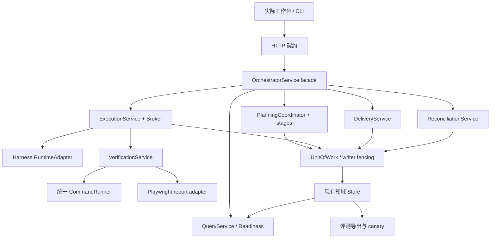
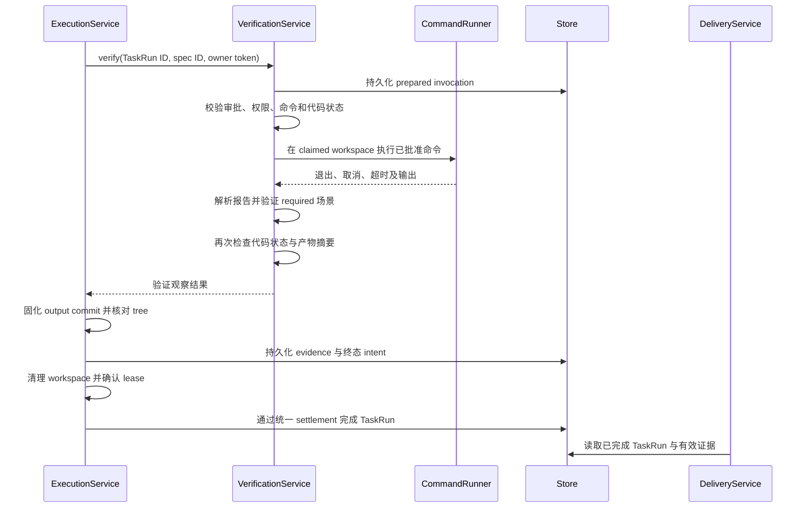

# 项目改进技术设计：验证闭环、规划评测与可靠恢复

> 日期：2026-09-22
>
> 代码基线：`dsh-project-orchestrator@1.7.0`，Git `726e728`
>
> 上游输入：[项目改进方案](project-improvement-plan-2026-09-22.zh-CN.md)
>
> 状态：设计基线已形成，确定性改造已部分落地，但正式发布资格尚未完成。第 2 至 15 节描述设计与验收契约，第 16 节记录当前工作区的实际实施状态；同名模块或接口存在不等于已通过外部验收。

> 2026-10-14 更新：[最新验收记录与剩余实施方案](project-acceptance-2026-10-14.zh-CN.md)。评测器的 Candidate V2 支持已存在，但 Service→CLI 的 V2 导出与重复运行冻结输入仍未闭合，第 16 节的历史摘要不能代替该项验收。

> 2026-10-16 更新：实际实施、真实 V2 导出、完整交付 canary、能力登记和发布门禁的最新状态见[项目验收报告](project-acceptance-2026-10-16.zh-CN.md)。本方案保留设计基线；当前正式发布资格仍未通过，历史缺口不作为当前状态证明。

## 1. 设计目标与范围

目标是让用户在现有 Harness 中完成“登记仓库 → 规划 → 审批 → 执行 → 真实验证 → 集成与交付确认”，同时能准确识别错误规划、错误阻塞和不确定写入。

本设计覆盖上游 T01–T11，分三批交付：

| 批次 | 范围 | 完成定义 |
| --- | --- | --- |
| A：真实验收 | 实际工作台 E2E、场景级验证、readiness 评测、真实 corpus 与 canary | 能证明目标场景实际执行，错误放行和错误阻塞都可检测 |
| B：可靠使用 | reconciliation、准备检查、阻塞恢复、Service 拆分与文档 | 失败有可操作恢复路径，新模块接入生产主链 |
| C：有界扩展 | 查询优化、语义索引、遥测、第二语言试点 | 用相同输入证明性能或效果改善，不扩大未知能力声明 |

保持以下边界：单 Host、本地存储、现有 HTTP/CLI 入口、已有人工审批与权限模型。本期不引入远程 daemon、分布式调度、微服务或新数据库；不自动发布代码、删除历史证据或扩大 Agent 权限。

## 2. 设计依据与现有契约

### 2.1 必须复用的现有实现

| 当前入口 | 已有责任 | 本次设计如何衔接 |
| --- | --- | --- |
| [插件入口](../src/index.ts) | 创建 Store/Service，注册 Host API 和生命周期 | 保留装配入口，逐步注入内部服务 |
| [OrchestratorService](../src/service.ts) | 规划、审批、分派、运行、恢复、集成 | 保留 facade，逐职责下移，不一次性重写 |
| [ExecutionBroker](../src/execution/broker.ts) | TaskRun claim、租约、heartbeat、执行契约 | 保留执行 owner 与过期拒绝机制 |
| [RuntimeAdapter](../src/execution/runtime-adapter.ts) | 已有 prepare/start/observe/cancel/artifact 接口 | 用真实 Harness 执行实现接入主链 |
| [BrowserVerificationProvider](../src/verification/browser.ts) | 执行命令并收集文件 | 升级为结构化场景报告验证，不依赖命令关键词 |
| [StorageUnitOfWork](../src/storage-unit-of-work.ts) | write-ahead intent、步骤进度、不确定失败 | 增加可重建步骤与恢复处理器 |
| [Store](../src/storage.ts) | 持久化表、事件序列、全量 snapshot | 保留权威记录，新增有界查询和版本化记录读写 |
| [评测契约](../planning-evals/contracts.mjs) | Gold、candidate、provenance、canary 校验 | 增加 readiness 和运行失败分类，保留旧数据识别 |
| [评分器](../planning-evals/grader.mjs) | 覆盖、owner、分派与 false-ready | 增加 false-blocked、原因准确性与显式分母 |

### 2.2 设计建立时不能忽略的基线事实

以下事实用于说明设计为何采用版本化证据、显式恢复和有界查询。其中部分缺口已在当前工作区落地，最新状态以第 16 节为准。

- `VerificationEvidenceRecord` 当前没有场景执行结果，kind 为 `test_command / artifact / delegation / review`。
- 现有 Verification、Intent 等 Schema 使用严格字段校验；直接向旧记录添加字段会导致不兼容。
- `runCommand` 已包含环境过滤、项目 `.venv`、输出截断、取消、超时和进程组终止，应统一复用。
- V3 当前在验证命令通过后才固化输出 commit，并在 TaskRun 终态前清理工作区；证据采集必须考虑这一顺序。
- Convergence 的验证摘要目前选择部分字段计算；仅增加新记录字段不会自动使旧摘要保护这些字段。
- 当前评测导出要求较完整的终态证据；早期正确阻塞和模型技术失败不能简单套用完整 ready 输出结构。
- 存储明确没有数据库事务、CAS 或唯一约束。进程内串行化和 workspace writer fencing 不能描述为分布式事务。

上游文档记录的 346 个 Node 测试通过、浏览器环境缺失和发布评测失败，是本次会话前一轮的执行证据。本轮不把它们表述为新设计已通过测试。

## 3. 业务不变量与事实归属

| 不变量 | 权威数据及写入 owner | 必须拒绝的情况 |
| --- | --- | --- |
| 原始需求不丢失、不被任务反向改写 | Requirement/Acceptance/Decision，由 Planning stage 写入 | 缺少必需需求、擅自缩小验收 |
| 执行内容等于批准内容 | PlanSnapshot、Approval、Dispatch，由审批/分派服务写入 | 版本、权限、团队或目标仓库摘要漂移 |
| 任务只有当前 owner 可推进 | TaskRun、claim、lease，由 ExecutionService/Broker 协调 | 取消后的迟到结果、旧 token、旧分配 revision |
| 验证必须对应真实执行 | Verification invocation 与 evidence，由 VerificationService 写入 | 零测试、旧报告、漏场景、未知来源报告 |
| 通过证据对应被交付代码 | TaskRun output commit/tree、Integration，由交付服务写入 | 测试后代码改变、集成目标改变或产物缺失 |
| 恢复只处理能够证明的状态 | Intent、RecoveryAttempt，由 ReconciliationService 写入 | 无法判断外部副作用、读取摘要不匹配 |
| 页面展示不产生业务授权 | Readiness、overview、query DTO 均为读取投影 | 前端按钮状态替代服务端审批门禁 |
| 评测失败不会被样本筛选隐藏 | Gold、run manifest、provenance、人工审阅记录 | 重复 operation、仅保留成功运行、fixture 冒充真实模型 |

## 4. 目标结构



新增边界首先通过内部参数注入，不增加网络跳数。每个服务只有与其职责相关的 Store 接口，禁止把整个 facade 传给子服务再反向调用。

`types.ts` 暂时保留公开类型再导出；契约可以逐域迁移，不能同时改变导入路径、序列化结果和运行行为。`client-types.ts` 与服务端 DTO 的一致性通过契约测试保护，后续再考虑生成。

## 5. 设计 A：可执行的真实验收链

### 5.1 验证计划与执行证据分离

Planner 继续输出场景、验证步骤和命令引用。Service 将其解析为受控 VerificationSpec，Planner 不能直接指定 Host 路径、reporter 插件或任意新 shell 命令。

拟新增 `VerificationSpecRecord`，持久化于 `verification_specs`：

```ts
type VerificationSpecRecord = {
  schemaVersion: 1
  id: string
  projectId: string
  planSnapshotId: string
  taskId: string
  provider: 'command' | 'playwright'
  providerContractVersion: string
  commandIds: string[]
  requiredScenarioIds: string[]
  reportContract?: {
    version: 1
    reporterId: 'dsh-playwright-json-v1'
    testMappings: Array<{
      scenarioId: string
      testFile: string
      testKey: string
      browserProject: string
    }>
    requireAllMappedTests: true
    allowFlakyPass: false
  }
  specDigest: string
  createdAt: string
}
```

规则：

- `commandIds` 必须来自当前冻结命令证据，实际 shell 表达式由已有命令 owner 解析。
- required UI Scenario 必须拥有 `playwright` spec；其他 Task 可以提供支持证据，但不能代替 UI 场景闭合。
- `testMappings` 使用稳定显式 key 与文件标识，不以可能重复的自然语言标题作为唯一键。
- 新增的测试文件可以在规划时尚不存在，但路径、创建责任和前置实现任务必须进入已批准 change contract。
- provider/spec/mapping/报告规则摘要进入 PlanSnapshot 的新版本摘要；修改这些内容会使旧审批失效。
- reporter 的可执行来源、注入参数和受管输出位置也进入受控执行配置；不能在批准后悄悄改写命令语义。无法安全接入已有验证命令时，先提出可审阅的测试基础设施任务。
- 同一 required Scenario 允许多个测试共同证明，所有已批准映射必须执行并通过；不得用一个任意通过测试替代整组。

### 5.2 Invocation 与证据记录

拟新增 `verification_invocations`，记录一次实际执行的权威上下文：

```ts
type VerificationInvocationRecord = {
  schemaVersion: 1
  id: string
  projectId: string
  taskRunId: string
  attempt: number
  specId: string
  specDigest: string
  planSnapshotId: string
  executionContractDigest: string
  commandDigest: string
  sourceStateDigest: string
  reportNonce: string
  state: 'prepared' | 'running' | 'finished' | 'cancelled' | 'interrupted'
  outcome?: 'passed' | 'failed' | 'unavailable'
  reportArtifactId?: string
  reportDigest?: string
  outputCommit?: string
  outputTree?: string
  startedAt?: string
  completedAt?: string
  failureCode?: string
}
```

执行 owner 和 VerificationService 独占写入这些字段。`reportNonce` 用于关联本次运行，**不作为防恶意仓库伪造的安全认证**。本地仓库测试仍属于已信任执行内容；业务正确性还需要独立验收与人工审阅。

`VerificationEvidenceRecord` 使用显式 storage union 读取：旧记录不带 `schemaVersion` 的路径保持原样；新记录写 `schemaVersion: 2`，增加：

- `kind: 'browser_test'`；保留原有 kind。
- `invocationId`、`specId/specDigest`、`sourceStateDigest`、`outputCommit/outputTree`。
- `scenarioResults[]`，包括 Scenario ID、实际 test key、browser project、断言结果、重试次数、原因码。
- `reportDigest`、`evidenceDigest` 和实际产物引用。

旧 `test_command: passed` 只保留其历史语义，不自动升级为浏览器通过。新摘要必须覆盖上述新字段，Convergence、canary 和导出逻辑必须使用相应版本算法。

### 5.3 执行与固化顺序



执行细节：

1. 执行前验证当前 claim、spec、plan、权限与命令摘要。为本次 invocation 创建新的 Host 管理证据目录。
2. 证据目录位于 worktree 外，使用服务端生成 ID，配置传入 runner；浏览器/API 不接受任意落盘路径。
3. 使用统一 CommandRunner，保留现有环境过滤、`.venv`、取消、进程组终止及有界输出语义。
4. 对 tracked 和批准范围内新增源码生成 `sourceStateDigest`；排除项仅限确定的临时测试产物，不能从 Agent 输出自由扩张。
5. 执行结束后比对代码状态。测试修改了待交付源码时，本次不能直接通过，应重新检查范围并重新验证新状态。
6. 报告验证通过后，沿用现有验证后固化 commit 的路径；重新计算其源码状态并与被测状态一致性校验。不能只相信报告自称的 commit。
7. 先把必要报告与失败产物归档到持久证据目录，再清理 worktree。证据未落盘、清理未完成或 owner 已变化时，不发布成功终态。
8. evidence 与终态更新纳入可恢复 intent；任务取消后可以保留迟到结果作审计，但不得计入成功覆盖。
9. Integration 后仍须对最终集成状态执行批准的集成验证；各 worktree 分别通过不能自动证明组合后的代码通过。

### 5.4 Playwright 报告协议

新增受维护的 reporter adapter，读取结构化测试结果，输出版本化报告。报告头包含 invocation ID、nonce、spec digest、runner 版本、起止时间与总测试数；报告正文包含稳定 test key、所属 browser project、actual status、retry、Scenario 映射及产物引用。

Service 同时验证：

| 条件 | 判定 |
| --- | --- |
| 非零退出、超时、断言失败 | `failed` |
| 找不到 runner 或浏览器 | `unavailable`，不可消费为通过证据 |
| 零测试、required 映射缺失、全部 skipped | `failed` |
| expected-failure/xfail、flaky 后通过 | 首版不得满足 required 场景 |
| nonce/spec/TaskRun 不匹配，重复 test identity，报告截断 | `failed`，保留原因 |
| required 测试全部正常通过、整体运行无失败、报告有效、代码状态一致 | 允许固化 `passed` evidence |

报告大小、测试数和产物总量采用有上限的配置。达到上限时返回明确错误，不能截断后继续给出 passed。artifact 路径必须规范化并拒绝越界和符号链接逃逸；最终下载只接受 artifact ID。

### 5.5 真实工作台 E2E 测试装配

新增测试基础设施建议落点：

```text
tests/support/test-host.mjs          # 测试进程与真实插件装配
tests/support/host-fixture.mjs       # 临时目录、端口、种子、重启与清理
tests/support/scripted-model.mjs     # 固定响应及调用计数，不替换业务层
tests/browser/project-lifecycle.spec.mjs
tests/browser/planning-blockers.spec.mjs
tests/browser/verification-evidence.spec.mjs
tests/browser/restart-recovery.spec.mjs
```

测试分两层：

- **PR 产品链路测试**：真实 bundle、React 组件、HTTP handler、Service、OrchestratorStore 以及落盘存储；模型调用边界使用确定性替身。宿主 shell 可以由最小兼容容器提供，但必须注册真实插件 UI。
- **发布 Host canary**：在认证 Harness 版本的隔离 Profile 中安装真实 npm 包，验证 slot、loader、依赖注入、模型执行和交付链。最小容器通过不能代替此层。

T02 的第一项工作是验证安装版本的 storage provider 如何注入临时路径、flush 与 close，并补一条重启后重读实验。不允许用当前 MemoryTable helper 替代持久化验收。

测试生命周期：创建独立临时 Git 仓库与 Profile → 配置受控目录及模型替身 → 启动 Host → 等待真实 health 和存储就绪 → 通过页面操作 → 对比存储/API/DOM → 关闭进程与文件句柄 → 仅清理本测试目录。重启测试复用同一临时存储，其他用例不共享。

不新增生产可访问的测试种子接口。种子由测试启动参数或专用进程通道输入。所有等待使用响应、状态或 DOM 条件，禁止靠固定 sleep 假定写入已完成。

## 6. 设计 B：同时评价正确放行与正确阻塞

### 6.1 Gold V2

保留现有需求、验收、owner、assignment 和 releaseInput，扩展以下字段：

```ts
type GoldReadinessV2 = {
  schemaVersion: 2
  expectedReadiness: 'ready' | 'blocked'
  expectedBlockingReasons: Array<{
    code: string
    subjectKeys: string[]
  }>
  requiredEvidenceStages: string[]
  pairedCaseId?: string
  review: {
    reviewer: string
    reviewedAt: string
    rationale: string
    goldDigest: string
  }
}
```

上例是增量字段示意，不能用它替代现有完整 Gold 契约。

规则：每个冻结输入只对应一个 expectedReadiness；确有多种合法结果时，先补充事实或拆成成对 case，不引入无条件 `either` 放宽门槛。Gold 中的 `requiredEvidenceStages` 由独立审阅者设定，候选不能自行宣布某阶段“不适用”。

### 6.2 Candidate 与运行尝试

Candidate V2 增加最终 `blockingReasons[]`、`reachedStage`、已完成阶段证据与人工评审引用，继续保留唯一 operation provenance。

另设评测运行 manifest，包含本批次全部尝试：

```ts
type EvalAttempt = {
  caseId: string
  attemptId: string
  operationId?: string
  outcome: 'candidate' | 'model_failure' | 'infrastructure_failure' | 'cancelled'
  candidateRef?: string
  failureCode?: string
  startedAt: string
  completedAt: string
}
```

技术失败不能转换为业务 blocked，也不能从统计中消失。补跑保留原尝试，遵守冻结重试预算。有效 candidate 数与总尝试数分别报告。

早期业务阻塞采用阶段感知导出：保留当时已冻结的输入、实际模型路由、已完成阶段输出和阻塞事实，不要求伪造尚未生成的 Task/Assignment。ready 导出继续要求完整链路。没有真实模型调用或完整 provenance 的早期预检结果，只计产品预检测试，不充当真实模型运行。

### 6.3 评分逻辑

| 指标 | 定义与分母 |
| --- | --- |
| falseReadyRate | Gold blocked 却输出 ready 的次数 / Gold blocked 的有效运行数；同时保留现有契约违反型 false-ready |
| falseBlockedRate | Gold ready 却输出 blocked 的次数 / Gold ready 的有效运行数 |
| blockingReasonPrecision | 命中 Gold 的原因事实数 / 候选给出的阻塞原因事实数 |
| blockingReasonRecall | 命中 Gold 的原因事实数 / Gold 要求的阻塞原因事实数 |
| firstPassApprovableRate | 首次输出 ready 且无需实质修改的 eligible case / eligible case |
| modelFailureRate | 模型技术失败尝试 / 实际发起模型调用的尝试 |

原因按 `code + subjectKeys` 的规范化集合比较，不依赖中英文文案一致。不同阶段适用的覆盖指标由 Gold 决定：合法早期阻塞不因缺少后续任务而误判；ready 仍必须满足全部需求、验收、owner、分派与 Preflight 契约。

分母为零返回 `not_applicable` 并显示样本数，不能默认为 100%。发布 corpus 必须同时存在 ready、blocked 与“补齐事实后恢复”的成对 case，缺少任一类别时发布资格失败。

现有 100% 必需覆盖、零高风险 Decision 绕过、零 false-ready 等门槛保持。新增错误阻塞阈值必须在第一批真实基线后由版本化 MetricPolicy 冻结；阈值缺失时不允许宣称新评测门禁已完成。确定性变异测试要求本次已知“全条件满足但仍 blocked”的样例明确失败。

### 6.4 数据组织与采集

继续使用现有 `planning-evals/`、Service 导出和 CLI 原子写入能力。新增 release corpus manifest 显式列出纳入发布的 case、Gold digest 和独立审阅信息。

- fixture suite 独立用于 grader 回归，所有 fixture 均不得计入发布资格。
- release manifest 一旦冻结，缺失 case、缺失运行、重复 operation、摘要漂移都直接失败，不自动跳过。
- 每次发布至少 8 个不同仓库、24 个独立 case、每 case 5 次带 provenance 的真实模型运行；当前要求不降低。
- Gold、模型配置、预算或评分策略变化时创建新批次，不覆盖旧结果。
- 业务样本只使用明确允许进入评测的仓库；私有源码留在本地，不把原始 Prompt/Transcript 默认纳入公开报告。

canary 在当前包版本下运行完整生命周期，绑定最终 commit、批准计划、所有相关 Dispatch、终态尝试、集成与 Convergence。增强后同时绑定场景证据摘要和人工交付确认。Host 安装 canary 与模型评测使用同一认证版本，不能拿旧包运行结果证明新包通过。

## 7. 设计 C：可预检、可恢复的持久化写入

### 7.1 Intent V2

现有 Intent 只描述步骤位置与动作，不能重建闭包。新增 V2 描述可重复验证的写入意图，旧 V1 原样读取。

```ts
type RecoverableWrite = {
  stepId: string
  table: string
  recordId: string
  before: { state: 'absent' } | { state: 'present'; digest: string; valueRef: string }
  after: { state: 'absent' } | { state: 'present'; digest: string; valueRef: string }
}

type IntentV2Extension = {
  schemaVersion: 2
  handler: 'planning-stage-write-v1' | 'planning-publish-v1' | 'verification-settlement-v1'
  expectedProjectRevision: number
  expectedProjectPointerDigest: string
  expectedWrites: RecoverableWrite[]
  expectedEvents: Array<{ eventId: string; payloadRef: string; payloadDigest: string }>
  intentDigest: string
  status: 'pending' | 'committed' | 'needs_reconciliation' | 'compensated'
}
```

`valueRef` 引用仅服务端可写的不可变 mutation payload，保存实际记录及 schema 版本，持久化后再写 intent。禁止在 ref 中使用任意文件路径；记录内容沿用领域存储访问边界，管理 API 只返回摘要与必要诊断。

同一 intent 中的 `(table, recordId)` 必须唯一，避免恢复时一个步骤的 after 又被后续步骤改写。事件描述引用完整的不可变事件 payload，供进程重启后幂等补发；事件不能从当前已改变的业务记录重新推导。

新增 `storage_mutation_payloads` 与 `storage_recovery_attempts`。`intentDigest` 覆盖 handler、前置事实和每步 before/after 摘要；提交状态、进度和时间等可变字段不进入其不可变核心。旧 intent 摘要算法不变。

### 7.2 写入与发布规则

1. 获取现有 writer fencing 和相应聚合的串行化边界。
2. 冻结 before/after 记录并持久化 payload，再持久化 intent。intent 未可靠写入前，不执行领域副作用。
3. 每步写前核对当前值：等于 after 表示重复执行，可校验后跳过；等于 before 才能写；其余状态必须 reconciliation。
4. 每步完成后持久化进度。进度保存失败时，恢复以实际记录摘要为准，不能只依赖 completedStepIds。
5. 计划候选子记录先写，权威 Project pointer 最后写；读取只通过当前权威指针确认生效记录。
6. 全部记录及不变量验证后才标记 committed。领域事件以固定 event ID 追加；事件缺失可幂等补发，不重复执行业务写入。

存在未解决 intent 的相关聚合由业务入口统一阻止继续审批、分派和集成，读取仍可展示事实与阻塞原因。Project pointer 已改变但 intent 未完成时，也不能只凭指针或页面状态继续执行。committed 后仅缺失通知事件，可以根据冻结的 expectedEvents 补发，不重新执行领域写入。

这是一套单写者条件下的可恢复协议，不是跨表 ACID。尚未纳入协议的旧路径仍按原契约处理，并列在能力矩阵中。

### 7.3 恢复预检

新增只读预检返回以下结果：

```ts
type RecoveryPreview = {
  intentId: string
  intentDigest: string
  observedStateDigest: string
  projectRevision: number
  expectedProjectPointerDigest: string
  verdict: 'already_applied' | 'replay_safe' | 'compensation_safe' | 'manual_required'
  allowedActions: Array<'finalize' | 'replay' | 'compensate'>
  steps: Array<{ stepId: string; actual: 'before' | 'after' | 'diverged' | 'unavailable' }>
  reasons: Array<{ code: string; subjectIds: string[] }>
  previewDigest: string
}
```

判定原则：

| 当前事实 | 恢复行为 |
| --- | --- |
| 全部为 after，业务不变量成立 | `already_applied`，可 finalize，不重复写 |
| 仅 before/after 混合，handler 明确幂等且无未知外部副作用 | `replay_safe`，只补未完成步骤 |
| 仅未发布候选部分写入，未被后续对象引用，有完整 before payload | `compensation_safe`，逆序补偿且逐步重验 |
| 有 diverged、不可读记录、V1 缺少重建事实、未知 Git/模型/网络副作用 | `manual_required`，不给自动恢复入口 |

首批 handler 只覆盖 Planning 的可证明内部记录写入；不能把 Git 集成、任意 shell 命令、模型调用或已发生的外部效果纳入通用重放。

### 7.4 执行恢复与并发控制

恢复请求必须包含 intent ID、expected intent digest、preview digest、expected Project revision、选择的 action、幂等 key 和操作说明。预检不改变状态，也不赋予操作权限。

收到请求后：解析已有 Command reservation → 获取 writer 与聚合串行化边界 → 重做预检并比对摘要 → 写 RecoveryAttempt → 执行允许步骤 → 校验不变量 → 写 intent 终态与恢复事件。

- 同 key 同请求返回同一操作回执；同 key 不同摘要按已有冲突契约拒绝。
- 两个恢复请求不能同时推进同一 intent；与正常规划或发布冲突时，返回稳定 conflict。
- `compensated` 是 V2 终态，相关查询、恢复扫描与 UI 必须一起更新，不能继续用简单的 `status !== committed` 判断未解决。
- 恢复中再次崩溃，继续按领域记录和 RecoveryAttempt 事实重新检查；不把旧 preview 当成许可继续写。
- 自动补发已确定的事件可以在启动恢复阶段执行；会改变业务事实的恢复需要明确操作请求。

### 7.5 故障注入验收

对每个纳入 handler 的边界，覆盖 intent 写前、业务写后进度写前、权威指针写后、event 写前、补偿中失败。至少增加真实子进程 kill/restart 用例；在 Promise 中抛异常不等价于进程突然退出。

验收同时检查：没有重复当前计划、没有错误 completed、旧 owner 无法继续、未解决 intent 可见、恢复后的事件不漏不重。无法确定的副作用保持人工处理状态。

## 8. HTTP、CLI 与错误契约

API 前缀继续使用 `/project-orchestrator/api`。下表是拟新增或扩展的接口，不是现有可调用能力。

| 方法与路径 | 请求核心 | 响应与副作用 |
| --- | --- | --- |
| `GET /projects/:id/readiness` | Project ID | 只读准备检查；无模型调用、不执行 manifest 命令 |
| `GET /projects/:id/overview` | Project ID | 有界摘要、阻塞、下一步、交付阶段 |
| `GET /task-runs/:id/verification` | TaskRun ID | invocation、场景结果、artifact ID；分页返回大结果 |
| `GET /admin/storage-reconciliation/:id/preview` | Intent ID | 只读 RecoveryPreview |
| `POST /admin/storage-reconciliation/:id/execute` | expected 摘要、revision、action、幂等 key | 返回 Command/RecoveryAttempt ID；不接受任意 table/value/shell |
| `GET /admin/storage-reconciliation/:id/attempts` | 游标、limit | 历史恢复回执 |
| `GET /artifacts/:id/content` | Artifact ID | 解析持久化元数据后读取受管文件，不接受路径参数 |

延续现有 `{ error: { code, message } }`。按需增加可选 `details`，用于 subject IDs、current revision 和可执行 action code；不返回凭据、未脱敏命令输出或任意存储内容。

建议新增稳定错误码：`verification-report-missing`、`verification-report-stale`、`verification-scenario-uncovered`、`verification-source-changed`、`reconciliation-stale`、`reconciliation-manual-required`。API 错误码与 TaskRun 的失败分类分别映射，不强迫全部持久化 enum 与 HTTP code 同名。

验证断言失败是已执行操作的业务结果，通过 VerificationEvidence 返回，不伪装成 HTTP 系统错误。过期请求和冲突使用现有 409 契约；格式错误 400；依赖不可用与存储错误沿用项目对应语义。

所有新写接口继承现有回环、Origin、Fetch Metadata 和 Command 幂等校验。`actorType: human` 是审计归属，不是新增身份认证。CLI 与 UI 必须调用同一 Service owner。

恢复 execute 完成 reservation 后返回 `202` 和可查询的 Command/RecoveryAttempt ID；同一请求的终态重放返回原有回执。前端通过现有 Command 查询能力获取进度，不能将 HTTP 请求超时解释为操作一定没有执行。

拟新增 CLI 子命令为 `readiness`、`verification`、`reconciliation-preview`、`reconciliation-execute`。执行恢复要求传递预检返回的精确摘要；`--help` 与 API 文档必须同步，不能通过 CLI 绕过网页门禁。

## 9. 产品交互设计

### 9.1 Readiness 只做事实检查

准备检查返回 `planningReadiness` 与 `executionPreparation` 两组结果，每项为 `ready / blocked / unknown / not_applicable`。检查仓库路径、Git 状态、支持栈、规模限制、可信命令、模型路由、项目团队与访问范围。

成员或能力尚未准备好，不必一概阻止只读分析；由服务端明确其影响是“不能开始规划”还是“计划后不能批准执行”。实际 Planning Preflight 和 Dispatch 仍重验全部硬条件。

技术栈探测只读文件与 manifest，不执行 npm script、安装依赖或自动发起模型请求。需要进一步探测时通过单独明确动作执行。

### 9.2 概览与下一步

沿用现有组件、Harness token、字号与键盘行为。建议概览结构：

```text
项目名称 / 仓库 / 当前交付阶段
当前结论：等待需求决策 / 可以审阅计划 / 验证失败 / 等待交付确认
主操作：查看并解决具体阻塞，或执行当前允许的下一步

需求与计划差异 | 当前执行 | 验证结果 | 最终变更
技术详情：摘要、Operation、规则、租约、恢复记录
```

`nextAction` 由 QueryService 从现有事实派生，使用受控 action code 和已知 ID，前端不执行服务端自由字符串命令。排序为：未解决存储不一致 → 必需决策 → 环境/能力缺失 → 计划审阅 → 执行/验证 → 交付确认。

### 9.3 阻塞与恢复

每个阻塞展示原因、影响对象、缺少的事实与动作入口。错误文案不只显示英文堆栈。恢复页先展示 preview、影响记录与可恢复/不可恢复依据，再明确提交 action。

异步操作使用三态反馈：处理中、完成、失败。客户端即使请求超时，也通过幂等 key 查询最终结果，不直接发起新操作。

当前 `api-client.ts` 主要把错误转换为 message；应扩展为保留 `code/status/details` 的内部错误对象，页面据稳定 code 呈现恢复动作，未知 code 使用通用错误展示。

### 9.4 状态与无障碍

任务通过、集成完成、Convergence 通过和人工确认分别展示。未执行的浏览器场景显示“未验证”，不能显示绿色通过。报告过期显示原因和重新验证入口。

实际 E2E 覆盖 loading、empty、error、blocked、窄屏与长路径；键盘操作、焦点回归和非颜色状态提示必须在真实 DOM 中验证。视觉风格沿用现有设计，不引入新主题或组件体系。

## 10. 渐进拆分与 Runtime 接入

按下列顺序迁移，每步保持旧 API 与行为测试：

1. 抽出 CommandRunner 和 VerificationService，接入当前 `execute()`，统一环境与终止行为。
2. 将 checkpoint 辅助模块扩展为真正的 PlanningCoordinator；逐次迁移 Binding、Task shaping、Assignment，不改变原始阶段顺序与摘要含义。
3. 从 `runAgent()` 抽出 Harness RuntimeAdapter，实现已有接口，并由 ExecutionService 调用。
4. 将 Integration/Convergence 放入 DeliveryService，保留其 Git CAS 与权限校验；查询迁入 QueryService。

### 10.1 DeliveryService 的迁移边界与锁约束

当前工作区已完成 Delivery 的主要职责迁移：`DeliveryService` 负责交付投影、按 Project 读取 Verification/Review/Delivery、DeliveryRecord 不可变字段校验、`ready -> delivered -> closed` 状态推进、V3 Integration/Convergence，以及执行完成后 Review/Delivery 创建和 Project/Run 终态协调。Integration 保留授权/冻结契约、canonical branch 与 cleanliness 校验、TaskRun 输出闭包、cherry-pick、`update-ref` CAS 和 inclusion evidence；Convergence 保留最终仓库快照、验证/验收/场景/策略/范围检查与失败补偿。`PlanningCoordinator` 已接管 V3 stage 顺序、Attempt、Checkpoint/Event、PromptReferenceManifest、重启证据判定和 Repository Policy successor 决策；`BindingStage` 已接管提示策略与核心证据链；`PlanningReviewStage` 已接管 Binding/Plan 共用的摘要、独立性、继承、模型反馈、Review 写入及 RepairAttempt 的 lineage/预算/状态推进、同 Project Policy successor 转绑和技术失败显式重开，仓库重读和 Harness 调用由 facade 注入。`AssignmentStage`、`TaskPreflightStage`、`TaskShapingStage` 已进入主链。项目可重规划判定、候选整体发布及 successor 实际启动仍由 `OrchestratorService` 执行，T08 因此仍是部分完成。

最终职责边界如下：

| 层 | 责任 | 禁止承担 |
| --- | --- | --- |
| HTTP | same-origin 校验、请求解析、错误序列化 | 获取业务写锁后再调用会自行加锁的 Service 方法 |
| OrchestratorService facade | 兼容既有公开 API、装配依赖、跨域流程协调 | 复制 Delivery 的状态判断和持久化规则 |
| DeliveryService | Integration/Convergence、交付投影、不可变记录、确认和关闭 | 直接修改执行 claim、审批或规划事实 |
| Store/UnitOfWork | 顺序写入、intent、恢复和持久化 | 推断业务状态或静默吞掉部分失败 |

`serializedMutation` 是进程内非重入锁。公开写方法必须由实际业务 owner 在最内层获取一次；HTTP 不能在外层再包同一把锁。否则 `review/resolve`、`delivery/confirm`、`delivery/close` 这类内部已加锁方法会永久等待自己。相关回归测试必须使用真实 `OrchestratorService + HTTP handler`，为 Review → Confirm → Close 设置有界超时，不能只用不会加锁的 fake service。

确认与关闭采用以下一致性规则：

- 在锁内重新读取当前 Project、Review、Delivery、Integration 和 Convergence，不消费锁外旧投影。
- V3 确认前检查 canonical target 的 HEAD 与 dirty 状态；长期目标是“锁外预检 + 锁内重新验证”，不能为了缩短锁时间删掉最终验证。
- DeliveryRecord 的证据字段一旦带 `immutableDigest` 即不可更改；只允许推进状态、操作者、时间和备注。
- DeliveryRecord 已写而 Project 写失败时恢复旧 DeliveryRecord。恢复也失败时必须留下 reconciliation intent，不能仅返回原异常。
- Activity 不是业务状态的 source of truth。确认/关闭后写 Activity 失败时，DeliveryRecord 的 `pendingAuditEvents` 保留待补事实，API 返回已提交的交付状态；重复请求、Host 启动或运行期间每分钟扫描均按固定 Activity/DomainEvent ID 补写。审计清理在写锁内读取最新 DeliveryRecord，防止迟到补写覆盖后续关闭状态。
- `delivered` 和 `closed` 重复请求返回当前记录，并仅补写缺失的待补 Activity；并发请求由同一 owner 锁串行化。

Delivery 的 Integration、Convergence、Review/Delivery 创建与 Project/Run 终态写入已迁移并通过 facade 等价回归和写入失败补偿测试；Git 与 Store 的跨边界恢复协议已覆盖 CAS/reset 窗口和真实进程重启。待补 Activity 可在重复请求、Host 启动或运行期间定时任务中幂等恢复。PlanningCoordinator 已接管阶段状态推进、恢复判定、PromptReferenceManifest 与 Repository Policy successor 决策；BindingStage、PlanningReviewStage、AssignmentStage、TaskPreflightStage 和 TaskShapingStage 已进入 V3 主链。RepairAttempt 的创建、预算、状态推进、successor 转绑与失败重开已由 ReviewStage 写入；候选整体发布和 successor 实际启动仍待迁移。执行终态保持单 owner。

### 10.2 Integration Git CAS 后的可恢复提交

当前 Integration 先在隔离 worktree 生成目标 commit，再对 canonical ref 执行 `update-ref <after> <before>`，然后写 inclusion evidence 和 Integration snapshot。CAS 成功后若证据或 snapshot 持久化失败，Git 已推进而 Store 仍是旧状态；直接重试会把已知的自己写入误判为外部 target movement。这是必须显式恢复的跨边界不确定状态。

拟新增 `DeliveryIntegrationIntentRecord`，至少持久化 `projectId/planSnapshotId/integrationId/sequence/taskRunId`、repository identity、target ref、`beforeCommit/beforeTree`、`afterCommit/afterTree`、证据摘要、已完成步骤和 intent digest。提交顺序为：

1. 在隔离 worktree 生成并验证 `afterCommit`，在任何 canonical 写入前持久化 `prepared` intent。
2. 重新校验 repository identity、target ref、cleanliness 和 `beforeCommit`，执行带 old-value 的 `update-ref` CAS，随后将 intent 标记为 `ref_updated`。
3. 根据已验证的固定载荷幂等写 inclusion evidence 和 Integration snapshot，完成后标记 `committed`。Project 指针只能引用已完成的 snapshot。

重启或重试时先对账 intent 与 Git：

| 当前 target ref | 处理 |
| --- | --- |
| 等于 `beforeCommit` | 允许重放 CAS，但必须再次校验 clean worktree 和冻结契约 |
| 等于 `afterCommit` | 重算 tree/patch/evidence digest，一致时只补写 Store，禁止再次 cherry-pick |
| 其他 commit | 标记 `manual_required`，不自动 reset、force update 或覆盖用户变更 |

`update-ref` 成功但 canonical worktree reset 未完成时，只有在 index/worktree 仍可证明等于记录的 `beforeTree` 且无新 untracked 文件时才可自动收口；否则转人工处理。故障注入必须覆盖 intent 写入前、CAS 前后、reset 前后、evidence 写入前后、snapshot 写入前后、重复恢复和外部 ref 移动。

当前工作区已实现并验证这一协议：在 CAS 前持久化冻结身份、before/after commit 与 tree、完整 inclusion evidence、Integration output 和 `intentDigest`；使用隐藏 recovery ref 保护 prepared commit；重入时按 `beforeCommit / afterCommit / 其他 commit` 三种状态分别重放、补写或转 `manual_required`。evidence 或 snapshot 写入失败后可从 intent 幂等重建，ready snapshot 已存在而 Project 指针写入失败时可补写指针；外部 ref 已推进时不会 reset、force update 或覆盖外部提交。新表已纳入项目删除级联和 Planning V3 存储可用性门禁；两 Task 用例证明第二个 CAS 后失败不会重放第一个已提交输出；ready replay 会先校验 committed intent/evidence 闭包，再补 Project 指针并重试清理残留 recovery ref。可注入 Git runner 已精确覆盖 CAS 成功但 reset 尚未发生的窗口：index/worktree 仍等于 `beforeTree` 时自动 reset 到冻结的 `afterCommit`，index、tracked 或 untracked 任一用户漂移时均转 `manual_required` 且保留用户内容。另有真实 JSON Store 子进程在该窗口被 `SIGKILL` 的测试，证明重启后能从 durable prepared intent 收口，且不会重复 cherry-pick。

RuntimeAdapter 必须传播取消，保留原始 Session 为对话权威源，并从真实执行采集 artifact。运行失败也需要失败日志，不能只在 succeeded 时允许收集诊断。

prepare 后、start 前，把 adapter ID、execution ID 与 TaskRun claim version 的绑定持久化；这些新增字段采用版本化执行契约，不能改变旧 claim 的摘要解释。绑定保存失败不启动执行；start 响应不确定时先 observe，不能再次 prepare 并重复启动。

现有内存 executions map 在进程重启后不可恢复，因此 adapter 不宣称可以恢复旧进程。重启后沿用 TaskRun/lease 的确定性判断：从未开始可重新排队，已发生副作用但不确定则 reconciliation。

terminal TaskRun 完成、清理和 evidence settlement 仍只有 ExecutionService 一个 owner。adapter 返回 succeeded 不得直接修改 Issue、Project 或 Approval。

## 11. 有界查询、索引与观测设计

### 11.1 事件与按需查询

保留 `/events` 和全量 `/snapshot` 兼容接口，但 Workbench 启动使用版本化的 `/bootstrap` 投影；`/snapshot` 只用于兼容、诊断和显式导出，不进入正常首屏链路。前端打开 Project 或 Issue 后，再按页面需要读取 overview、TaskRun、Activity、Transcript 和 Artifact。

`WorkbenchBootstrap` 的首版契约包含 `schemaVersion`、有界 `snapshot` 和未裁剪的 TaskRun/Activity/Transcript/Artifact 总数。投影规则为：

- 保留所有活动 TaskRun、每个 Project/Issue/Task 的最新 TaskRun，以及被 Issue、Decision、Delegation 当前引用的 TaskRun，并按 ID 去重。
- Activity 每个 Project/Issue 最多保留最近 5 条，Comments 每个 Issue 最多保留最近 50 条。
- 只保留当前 PlanSnapshot、其 Requirement bundle，以及当前 revision 的 Review/Delivery。
- Transcript、Artifact、Command、ExternalTrigger 和不供首屏直接消费的 Planning V3 历史不进入 bootstrap。
- 启动投影中的数组长度不是历史总数；本地数据页必须使用 `totals`，不能用裁剪后的数组长度冒充总量。

按需读取接口首版包括：

| 接口 | 用途 | 首版边界 |
| --- | --- | --- |
| `GET /issues/:id/context` | Issue 最近运行、Activity 与对应证据 | TaskRun 100、Activity 200、Transcript 1,000、Artifact 200，超限返回 `truncated` |
| `GET /task-runs/:id/transcript` | 单个 TaskRun Transcript | 直接查询 Store，不通过完整 Snapshot 过滤 |
| `GET /task-runs/:id/artifacts` | 单个 TaskRun Artifact | 直接查询 Store，不通过完整 Snapshot 过滤 |
| `GET /projects/:id/task-run-artifacts` | 当前分页可见 TaskRun 的 Artifact 批量读取 | 最多 100 个 TaskRun ID，每个 TaskRun 最多 20 条 |

Issue context 的 `totals.transcripts` 与 `totals.artifacts` 现按 Issue 的全部 TaskRun 及直接归属 Issue 的 Artifact 计算；返回列表仍分别限制在最近 100 个 TaskRun、1,000 条 Transcript 和 200 份 Artifact。UI 在总数大于已加载数时展示“已加载/总数”，并在旧运行仍有证据时保留明确空态。真实产品组件与 JSON Store 的浏览器用例验证了 101 次运行、101 条 Transcript 和 303 份 Artifact 的计数与渲染；这不是 100 项目规模的性能证据。

事件作为失效通知，不直接覆盖权威记录。收到事件只标记受影响聚合为 dirty，合并刷新；写操作完成后仍强制重新读取相关事实。

- 每类查询只保留一个在途请求，后续刷新合并为 pending，完成后再发。
- 通过 generation 与资源 ID 拒绝旧页面结果；避免每 2 秒发新请求导致慢结果永远失效。
- 启动时一次构建 event sequence 索引和高水位，append 持久化成功后更新内存索引；重启从日志重建。
- 游标页面返回 `nextCursor`、`hasMore` 与 `watermark`。只有快照及对应游标都成功应用后才推进客户端 checkpoint。
- 连接失败保留最后成功数据并标记过期；发生游标缺口时重新取得 snapshot，不静默跳过。

历史不可变记录使用 `(createdAt, id)` keyset 游标并冻结首屏 watermark。活动任务列表按项目获取有界完整集合；如需跨页浏览可变列表，使用固定 ID 集合的短期查询快照，避免 updatedAt 变化造成翻页丢项。

暂不引入 SSE/WebSocket。当前 `OrchestratorService.getWorkbenchBootstrap()` 仍调用完整 `snapshot()` 后再投影，因此已经降低网络载荷但没有消除服务端全表扫描。只有在真实负载证明该扫描成为瓶颈后，才把投影下沉为 Store 原生有界查询，并保持 `/bootstrap` DTO 不变。

当前可复现的 `pnpm benchmark:query` 合成基准为：

| 规模 | 完整 Snapshot JSON | Bootstrap JSON | 比例 | Snapshot 构建 | Bootstrap 投影 | 首屏历史查询 |
| --- | ---: | ---: | ---: | ---: | ---: | ---: |
| 10 Project / 1,000 TaskRun | 1,276,817 B | 28,719 B | 2.25% | 6.950 ms | 2.949 ms | 0.271 ms |
| 100 Project / 10,000 TaskRun | 12,861,337 B | 281,903 B | 2.19% | 15.956 ms | 6.337 ms | 1.096 ms |

每个场景包含等量 Transcript、Artifact 和 Activity。该基准验证结构有界与 payload 缩小，不设置易抖动的严格毫秒门槛；数据来自本机合成负载，不是生产性能、真实用户渲染或认证 Host 证据。

### 11.2 Repository Index

复用已有 Provider SPI。第一步改进 TypeScript module resolution、alias、re-export 和反向引用，保留“解析覆盖”与“找到正确 owner”两个不同指标。

缓存 key 使用仓库身份、base commit、dirty digest、Provider 版本、配置摘要和索引格式版本。变更、rename、删除或配置变化均失效；无法证明缓存当前有效则重建或返回 partial。

大型仓库按 package/模块建索引，但仍报告全仓覆盖和未覆盖模块。文件预算不足必须显式标记，不能局部命中后宣称全仓支持。第二语言根据真实 corpus 决定；本文不指定尚未经需求验证的新 Provider。

### 11.3 度量

复用现有 StageAttempt、TaskRun 与 DomainEvent，增加实际阶段开始/结束、检索/模型/验证分段耗时、重试原因及人工等待时间。跨重启使用持久时间戳，同进程耗时使用单调时钟，避免只测 stage commit 的写入时间。

token/费用未知就记 unknown。按有效交付统计成本时包含规划失败、修复和执行失败消耗。默认本地聚合，不添加外部遥测上传。

## 12. 版本、迁移与回退

| 对象 | 兼容策略 |
| --- | --- |
| Gold/Candidate V1 | 可继续读取和运行历史 fixture；新 readiness 资格要求 V2，不给 V1 自动补推断值 |
| VerificationEvidence V1 | 原样读取、保持原摘要；不能补造 Scenario 通过结果 |
| PlanSnapshot/Approval | 新 spec 摘要启用新的显式版本；旧已运行任务保留历史事实，新执行需要对应版本的有效审批 |
| Intent V1 | 保持原 schema/digest；没有足够 before/after 证据时仅人工处理 |
| Intent V2 | 新 handler 和 payload 先可用，再允许写入；所有扫描器同时支持 compensated |
| 新表 | 按现有兼容表机制注册，缺表可读历史但新功能明确 unavailable；不得用内存 fallback 冒充持久化 |
| Convergence/canary 摘要 | 增加版本字段，新证据集合使用新算法；不以新算法重新解释旧签名内容 |

采用“兼容 reader → 写入与内部链路 → 隔离验证 → 新流程入口”的发布顺序。读写同时升级时，Host 初始化先检查依赖与表能力，失败则拒绝相关功能。

尚未写入新格式数据前，可以禁用新入口并回退代码。写入新格式后，旧包回退必须停止队列并恢复配套备份，或使用经过独立验证的下迁工具；禁用功能不等于旧版能够读取新记录。

迁移不会把历史 completed 自动升级为符合新验证协议的交付。已有成功状态保留并标记其证据版本；需要新资格的交付重新验证。

## 13. 实施拆分与验收追踪

下表与改进方案中的 ID 一一对应。路径表示设计归属；文件存在只说明已有落点，不代表主链接入、行为验收或发布资格已经完成。

| 任务 | 主要落点 | 关键交付 | 验收用例 |
| --- | --- | --- | --- |
| T01 | `planning-evals/contracts.mjs`、`grader.mjs`、`run.mjs` | Gold/Candidate V2、运行 manifest、错误阻塞指标 | ready/blocked 成对、全 blocked 变异、零分母、模型失败不漏记 |
| T02 | 新增 `tests/support/`，扩展 `tests/browser/` | 真实 bundle/业务层/持久化 Host fixture | 空项目零 AI、副作用计数、刷新与重启、键盘与窄屏 |
| T03 | 新增 `src/verification/service.ts`、reporter；扩展 `browser.ts`、`service.ts`、`types.ts`、`storage.ts` | spec、invocation、V2 evidence 及主路径接入 | 零测试、过期报告、源代码变化、取消、失败产物留存 |
| T04 | `planning-evals/`、现有导出 API/CLI | 独立 Gold、真实模型采集与完整尝试清单 | 8 仓库/24 case/每 case 5 次；不重复 operation |
| T05 | canary 契约与隔离 Host 脚本 | 当前版本完整交付证据 | 审批、Dispatch、TaskRun、验证、集成、收敛、确认一致 |
| T06 | 新增 `src/storage/reconciliation.ts`，扩展 UnitOfWork/HTTP/CLI | Intent V2、preview、execute、RecoveryAttempt | 每一步故障、重复恢复、并发恢复、进程 kill/restart |
| T07 | 新增 readiness/overview 查询；`client.tsx`、`api-client.ts`、`client-types.ts` | 前置检查、阻塞动作、验证与恢复页面 | 按稳定原因码操作，过期 UI 不绕过服务端 |
| T08 | `planning/coordinator.ts`、`planning/*-stage.ts`、`execution/runtime-adapter.ts`、`delivery/service.ts`，逐步拆 `service.ts` | 单 owner 的内部职责、真实 adapter 接入、Delivery 状态迁移 | 取消、租约、旧结果 fencing、交付不可变字段、Review → Confirm → Close 无嵌套锁、恢复行为不变 |
| T09 | quickstart、operations、architecture、验收脚本 | 能力矩阵、入门流程、可信报告 | 干净 Profile 按文档走通，报告无硬编码通过 |
| T10 | 新增 QueryService，扩展 Store/API/client | `/bootstrap` 有界启动投影、事件索引、按需证据、分页与在途控制 | 高历史量不漏数据；首屏不读取 `/snapshot`；旧响应不覆盖新状态 |
| T11 | `planning/providers/`、`repository-evidence.ts`、stack profile | 语义关系、缓存与规模预算 | alias/re-export/rename、缓存过期、超预算明确 partial |

推荐实施次序：T01/T02 建立基线；T03 接入主链；T04 分批采集；T05 验收闭环。T06/T07 随后完成可靠使用，T08 按实际改动顺路拆分。T10/T11 必须先取得负载或规划失败归因证据。

## 14. 测试与发布门禁

### 14.1 最小验证矩阵

| 层级 | 正例 | 反例与边界 |
| --- | --- | --- |
| 契约 | V1 读取、V2 写入、摘要稳定 | 未知版本、缺必需字段、跨任务引用、摘要篡改 |
| 验证 | 真实浏览器全部 required 通过 | 打印伪成功、零测试、skipped、flaky、旧报告、代码变化 |
| 评测 | 应 ready / 应 blocked 均正确 | 错误拒绝、错误放行、错误原因、重复操作、隐藏失败 |
| 恢复 | 已写事实确认、幂等补写 | 记录漂移、补偿失败、两请求竞争、写后崩溃 |
| UI | 空项目、规划、审批、执行、交付 | loading、empty、blocked、错误、断线、重复点击、焦点恢复 |
| 性能 | 正常规模与历史增长 | 慢请求、游标过期、更新中翻页、超大报告 |
| 发布 | 真实包、真实认证 Host、当前 canary | 旧包证据、fixture 冒充模型、缺 corpus、旧审批 |

### 14.2 门禁分工

- PR：类型检查、文档检查、现有 Node 回归、新契约与故障测试、真实产品链路浏览器测试、fixture grader、package smoke。
- 发布：PR 门禁全部通过，Ubuntu/macOS 认证结果、完整真实模型评测、MetricPolicy 阈值、当前版本 Host canary 与升级/恢复演练。
- 任何必需能力 unavailable 都列为未完成，不能通过删断言、降低样本数或把模拟结果计入真实证据消除。

现有示例浏览器测试可以保留，但报告中明确标为基础设施测试。源文件字符串断言继续用于静态契约，不能代表交互和持久化链路通过。

## 15. 待确认项与设计完成边界

| 决策 | 当前默认设计 | 何时必须确定 |
| --- | --- | --- |
| 真实评测仓库、样本与模型预算 | 先使用明确允许的本地样本，不自动运行付费批次 | T04 执行前 |
| 新增 false-blocked 等指标阈值 | 先建基线，再冻结版本化策略；未冻结不计新资格完成 | T05 发布资格前 |
| 第二主语言 | 按真实目标仓库需求选择，不同时扩三种语言 | T11 第二阶段前 |
| 纯文档 AI 工作是否采用轻量契约 | 暂沿用现有流程，不暗中删除实现/验证要求 | 单独产品需求确定后 |

这些决策不阻塞 T01、T02、T03 的确定性契约与测试基础设施设计。本文交付的是设计基线，不把当前工作区实现、真实模型运行、用户环境修复或发布操作自动计入设计完成。

本文件的实施验收以第 13 节任务映射与第 14 节验证矩阵为准。组件存在、单测通过、主路径接入、真实 Host 验收和发布资格通过必须分别记录。

## 16. 当前实施状态

截至 2026-09-22，本设计已在当前工作区完成以下确定性主链：

- Gold/Candidate V2、readiness/false-blocked 指标、运行 manifest 与正式发布门禁；
- 真实 bundle + HTTP + Service + Harness JSON Store 的隔离浏览器 Host；
- VerificationSpec、Invocation、V2 Evidence、结构化 Playwright 报告消费和源码状态绑定；
- Intent V2、Recovery Preview/Attempt、重放/补偿/收口，以及真实进程 kill 后的持久化恢复；
- Overview/readiness/reconciliation UI、`/bootstrap` 有界启动投影、QueryService、按需证据接口、事件高水位索引、历史 watermark 分页与客户端单在途刷新；
- RuntimeAdapter 的 prepare/bind/start/observe/cancel/artifact 主链，以及重启后的可重试绑定清理和不确定运行审计保留；
- DeliveryService 的交付投影、Verification/Review/Delivery 查询、DeliveryRecord 不可变校验、确认与关闭状态迁移，以及 V3 Integration/Convergence；对应 HTTP 路由已移出外层 `serializedMutation`，避免与 Service 内部写锁形成非重入嵌套；
- Delivery Integration intent 主链：CAS 前冻结 Git 与 Store 契约，隐藏 recovery ref 防止 prepared commit 被回收，重入时按 target ref 状态幂等补写 evidence/snapshot，外部 ref 漂移时转 `manual_required`；CAS 到 reset 边界已覆盖自动收口、index/tracked/untracked 漂移保护和真实 JSON Store 子进程 `SIGKILL` 后恢复；
- 共享 `gitProcess` 命令边界与 `gitCommitEvidence` 证据计算，分别供 TaskRun 输出固化和 Delivery Integration 使用；
- TypeScript alias、re-export、反向 consumer、缓存失效和文件/字节预算。

T08 RepairAttempt 转绑与重开迁移后已重跑完整 `pnpm verify`：typecheck、docs check、436/436 Node 测试、6/6 浏览器测试、5 次 fixture 规划评测和 package smoke 全部通过，package smoke 产出包含 136 个文件的 `dsh-project-orchestrator-1.7.0.tgz`。PlanningReviewStage 直接回归为 8/8。`pnpm benchmark:query` 在 100 项目及 10,000 条 TaskRun、Transcript、Artifact、Activity 的合成数据下，全量 JSON 为 12,861,337 B，bootstrap 为 281,903 B。浏览器 Host 使用真实产品组件和落盘 Store，但模型边界为 fixture；查询基准使用合成数据，因此二者都不属于真实模型评测、生产性能或认证 Host canary。fixture 评测的 readiness 新指标本轮无适用样本，release qualification 仍因仅 1 个仓库/1 个需求且缺失 canary 而失败。

仍未满足的设计完成条件：

1. T04 的 8 仓库、24 case、至少 120 次真实模型运行与独立 Gold 审阅；
2. 当前安装包在认证 Harness Profile 上的完整 T05 canary；
3. false-blocked 等新增阈值基于真实基线的版本化冻结；
4. T08 中 PlanningCoordinator 已接管 stage 状态推进、恢复判定、PromptReferenceManifest 及 Repository Policy successor 决策，BindingStage、PlanningReviewStage、AssignmentStage、TaskPreflightStage 和 TaskShapingStage 已进入主链；候选整体发布和 successor 实际启动仍需从 11,283 行 `OrchestratorService` 下移，项目可重规划门禁仍由 facade 协调。Delivery 的 Integration/Convergence、交付记录创建、Project/Run 终态协调、Git CAS 恢复、reset 边界和真实进程重启证据已迁入或闭合于 DeliveryService；待补交付 Activity 支持启动和运行期间重试；
5. T09 的干净认证 Profile 复现与 5 位目标用户/维护者可用性研究；
6. T10 的 Store 原生有界投影决策，以及 100 项目规模下的真实浏览器渲染基准；Issue context totals 语义已收敛；
7. 由真实 corpus 决策并验证的第二语言 Provider。

因此当前状态是“主要确定性能力已实现，发布资格未完成”。不得把 fixture、合成负载、静态检查或本地兼容 Host 写成真实模型、认证 Host 或正式发布证据。

## 17. 真实评测反馈后的证据契约（2026-10-16）

场景独立审阅必须收到冻结 source manifest（含锚点正文）、需求/AC 分析及已选决策的具体选项，连同风险、场景策略、场景和源码证据共同纳入输入摘要。记录 sourceContext；审批、派发、计划健康与前序复用核对同一摘要，历史无该字段记录保持原摘要语义。只提供风险与锚点 ID 无法判断场景是否受原需求支持。

事件事实链区分 `durability: persisted | transient`。缺省保留历史 persisted 语义，要求非空真实持久化集合 owner；transient 必须使用空 `persistedCollectionOwnerSymbols`，不得用任务状态或测试数组充当生产事件集合。两类都必须保留事件/载荷声明、生产者、读取/监听、fixture、assertion、correlation、absence 语义及逐项 EVT 绑定；其 required impact 不因瞬时分类减少。分类要经独立源码审阅，生成、落盘和复用完整保留，未知 SCN/EVT 诊断引用继续拒绝。只有场景的 `observableAt` 包含 event 时要求相应结构化事件声明，单纯 test 通道中的回调计数不自行扩张需求。

源码证据在既有 64 KB 总预算内优先保留需求点名声明、同文件直接调用链和实际 package exports/re-export 公共入口。大模块采用完整声明片段与来源行号；完整去注释实现能容纳时保留其全部可执行内容。未提供部分继续标记 truncated，不能推断片段外事实；检查证据不扩大可写范围。只读审计用完整 AST 声明对比实际冻结仓库，模型真实复验另行记录。

本轮状态与证据以[2026-10-16 验收报告](project-acceptance-2026-10-16.zh-CN.md)为准。256 项能力和 greeting V2 canary 已正式登记并复核；完整本地验证通过仍不代替同 bundle 的 25 样本、8 仓库、至少 125 个有效独立真实候选及正式 release gate。

原文明示的 `AC-* [category, required]` 必须保留到该 Acceptance 的策略类别，不因自然语言关键词未命中而降为 not_applicable；只读取其所属源锚点，普通标签与文件名不构成声明。显式安全类别同步保留 security 风险，类别来源记录为 `source-explicit-*`。

TaskPreflight 核实当前代码 owner、可执行验证入口、必要写权限和精确目标；待新增或加强的回归属于 Task 工作，不能要求在接手前已经完成。不得把未见测试声称为已存在或已执行。确实依赖某个指定既有 fixture/test 的身份与内容、缺真实 owner/runner、缺验收语义或需要禁止写入时，继续返回具体缺口。Task 级禁止范围优先于更广的仓库授权；这一边界用真实模型正例和权限冲突反例诊断，不能仅靠提示文本或模拟测试宣称有效。

### 18. 参数声明及短转发模块的证据完整性

v18 的 Zod trim 已通过独立场景审阅，随后真实 Binding 拒绝：64 KB 共享预算留下 `_stringbool` 实现，却挤掉同文件 `$ZodStringBoolParams`；短 `mini/parse.ts` 仅保留导出列表前缀，丢失来源模块。原失败保留，不通过放宽声明审阅取得通过。

在证据选取层修复：目标函数的本地参数/返回类型及继承声明沿最多两层本地依赖保留；调用实现链继续保留。签名类型的通用基础设施不自行成为新的跨模块运行时根，避免它挤掉 `$ZodString`、`$ZodCodec` 和实际执行器。`required` 等 schema 标签、语言关键字和常用任务动词不当作主声明请求；源码发现的精确依赖仍可覆盖该过滤。需求明确点名的符号和来源约束保持有效。

已选依赖中不超过 1 KB、仅由 import/export 组成的完整短模块，按大小在既有 8 KB 依赖预留内优先保留全文件；超限仍显式截断，64 KB 总预算、冻结源码摘要、仓库边界与写权限不变。没有新增依赖或扩大可写范围。

新增预算压力回归检验完整参数契约、完整转发来源、普通标签不触发无关 owner、真实同名依赖仍可追踪及确定性。真实源码只读对照脚本 `scripts/verify-binding-parameter-forwarding.mjs` 用实际失败 bundle 重放修前缺口，再与本地修后完整 AST 声明逐个比较，并保留原 operation 和全部摘要。既有 Hono/Zod 证据检查及 pqueue 完整可执行 owner 复查继续执行；这些审计不算真实候选或 release 通过。

### 19. 编译期类型断言的来源约束

v19 的真实独立场景审阅指出：生成器把不同 public variant 的泛型默认值混为一谈，以运行时只接受字符串推导编译期也必须拒绝其他值。mini/core 的输入投影可能为 unknown，classic 测试的 string 输入断言不能替代其声明。无依据的 `@ts-expect-error` 会产生未消耗指令错误，且不能通过扩大声明写权限迎合断言。

修复归属场景生成层：精确类型相等和每个编译期负例必须有该入口的真实声明或明确新目标契约支持；保留 boolean 输出并不允许收窄 unknown 输入。需要类型负例时检验源要求的边界，例如明确要求的新 boolean 参数的错误值，而非捏造 decode 输入限制。类型测试使用真正的编译入口，负例不在运行时执行，不冒充已执行结果；要求的类型覆盖和写权限保持不变。

更新场景指令版本，防止旧场景继承；独立审阅文本与拒绝标准不变。使用冻结 trim/overlap 输入分别对比原生成提示与新提示，随后交给同一原独立审阅提示；不传候选评分、不重试原 operation，不计 release 候选。真实对照及完整验收结果分别记录，提示文本检查和本地测试不能代替模型效果证明。

v20 真实运行还表明，约束本身不能把“保留 boolean 输出”扩写为“额外证明完整输入类型等式”。只有提出具体类型断言时，才追踪支撑该断言所需的声明；原 Acceptance 明示的目标输出类型可以直接作为待实现的编译期 oracle。真正必需的 oracle 缺证据仍阻塞；可选的更强断言没有依据时不应引入。该边界修正经 v20 overlap 的冻结输入及同一原独立审阅真实诊断批准，不改判原失败。

### 20. 仓库验证命令的来源及精确调用

v20 Zod trim 已越过场景与 Binding 审阅，但 TaskPlan 发现命令目录将 `pnpm-lock.yaml` 当作工具选择，覆盖 `package.json` 的 `nub@0.8.3`。目录也只有少数根脚本，缺少原要求的类型诊断和仓库 MUST 策略所需的测量入口。修复归属 repository snapshot 的命令发现层，不能让模型把 pnpm 引用解释成 Nub，或用普通构建替代类型检查、性能、内存及包体积结果。

显式 `packageManager` 优先；只在未声明时沿用 lockfile 推断。不支持或无效的显式值拒绝，不静默替换。根 manifest 的现有验证、benchmark、bundle 脚本进入候选目录；声明 TypeScript 依赖且存在对应配置时提供独立 `tsc --noEmit --project` 入口。Nub 仓库可将根 AGENTS/CONTRIBUTING 的明确 benchmark 模板及测量约定，实例化为冻结清单中真实存在的文件命令：GC 开关、source condition、minify、gzip 与 classic/mini fixture 分别保留，不发明文件或写入输出路径。包体积管道启用 pipefail，依赖失败不能成为零字节成功。

最多 100 条候选命令；配置入口最多 12 个、包体积 fixture 最多 16 个，顺序确定且不依赖需求文本。该目录证明来源和调用形式，不证明工具已安装、命令已运行或测量已通过，也不授予执行权限。精确命令纳入 repository digest 和后续 opaque ref；既有人工能力事实不复制。回归覆盖显式工具优先、旧推断兼容、非法声明拒绝、文件存在性、范围边界、只读发现、确定性及管道失败传播。实际仓库只读前后对照另行落盘，最终仍以新 bundle 的真实候选和 release gate 为准。

### 21. 结构化类型投影闭包与阶段短语边界

v21 trim 的真实审阅缺少 `$ZodCodecInternals`、`$ZodBooleanInternals` 和 `$ZodTypeInternals`，因此无法核实 direct core 的 boolean 输出。实际 TypeScript 只读编译已证明 output=boolean、input=unknown；未知输入不能推导为未知输出。该证据缺口归 BindingStage 的冻结源码装配层，原拒绝记录保持不变。

接口与类型别名沿最多两层本地成员、继承关系保留完整声明；通用约束仍在完整声明中可见，但不展开其允许的全部 schema。类型参数经其他模块的泛型投影再沿最多两轮类型续查，并仅在真实 namespace import 及冻结的 re-export 链中定位 owner，最多三层导出路径。类型续查不新增同名运行时根。文件路径先从主符号词表移除，避免 `package.json` 误选无关 `json` 函数；源码发现的精确依赖不受这一过滤限制。

64 KB 总预算、8 KB 非显式 owner 上限与短转发预留不变；已由源码发现的 owner 先保留有界完整片段，再分配其余显式入口及模糊命中。完整 AST 比对同时覆盖类型投影、原运行时辅助函数和参数契约；不以符号名称出现代替完整声明，不扩大未来写权限。预算压力回归含跨模块 projection、同名运行时反例、路径后缀噪声、确定性与原有转发/执行 owner 断言。原场景加修后证据经原审阅真实批准，诊断不计 release 候选。

Service 的阶段兼容识别要求“未知/未来”实际限定“阶段”，不再将不同位置的“未来验证步骤”“编译阶段”“只读值”拼接成兼容要求。原本明确的未知阶段标识、独立审阅拒绝和反例继续阻塞；策略版本更新后重冻 Gold。Planner 对所有 Service 已判适用的 MUST 逐项核对 Task、命令及实际行为，禁止静默遗漏；不删除或重新分类策略。新 bundle 必须重新完成正式真实评测。

### 22. 测试夹具生命周期与策略脚本运行参数

v22 Hono 真实场景把 GET、OPTIONS 放在同一可变夹具上执行，最终又要求回调数组只有一个元素。独立审阅正确拒绝；修复归场景生成层，不能放宽审阅。生成时说明每个触发变量使用新夹具还是共享状态，何时创建/清空、何时断言；累计 oracle 必须包含自上次重置以来全部触发，禁止凭空引入去重语义或丢弃要求的触发分支。同步异常及异步拒绝均需要保持错误身份。冻结 Hono 的实际运行对照以独立脚本核实共享/隔离两类计数，不把模拟计数或提示文字检查当作行为证据。新旧提示使用相同冻结输入及原审阅规则另做真实对照，所有诊断均不计 release 候选。

v22 Zod 计划的 MUST 核对已暴露 dict-mode.ts 未注入命令，不能以通用测试或不改访问器替代明确测量。命令发现仅从根策略点名、Git 已跟踪、无路径穿越及符号链接的脚本，最多 16 个，读取最多 4096 字符的头部声明。明确的 `Run with: nub --allow-natives-syntax` 或 `--expose-gc` 才实例化调用；仅有路径、不支持的标志、任意可执行文本不生成命令。manifest 中唯一明确的 source condition 保持传递；既有 100 条目录上限及稳定排序不变。这是来源确认，不代表工具已安装、命令已执行或所有实例已实测为 fast。候选引用进入新冻结摘要，策略替代及原失败记录继续保留，最终按同 bundle 的正式门禁验收。

### 23. 类型检查入口保留仓库配置

v23 的 p-queue 场景已收到根 tsconfig、TypeScript 版本和既有编译 harness，仍自行组合 root-file 编译命令。TypeScript 6.0.3 在根 tsconfig 存在时返回 TS5112；使用 ignoreConfig 虽绕过该错误，却无法满足原需求的配置保留约束。问题归场景生成层，不增加源码预算，不改变独立审核，不扩大可写路径。

生成器优先使用已确立的类型测试命令或所提供 harness，同时证明指定文件确实纳入编译。若确需新增 harness，应沿现有模式继承配置、显式列出文件、使用 project 模式并清理临时产物；不能手抄一组 compiler flags 代替原配置，也不能把 source-only 构建声称为 test-d 验证。编译器版本、配置继承及文件发现任一不能确立时，保留具体缺口。更改场景版本指纹使旧场景不得被新流程直接继承。

验证包含隔离的正反编译实验、精确冻结工具源码检查、原/新提示与相同独立审核的真实对照，再执行新 bundle 的完整正式采集。诊断不计 fresh；旧失败保留；只有正式 release gate 的实际退出 0 才记整体验收通过。实现仅涉及 src/service.ts 的场景生成规则和版本，无新生产依赖；回退可重装保留的旧隔离包，但历史能力、审批及交付记录不回滚。

### 24. 参数化分支的输入与预期一致性

v24 的 Hono compatibility 场景把“匹配数组”和“不匹配数组”命名为不同模式，却为两者指定完全相同的数组和请求值，并要求相反结果。独立审核正确指出这不是可执行负例。生成器应逐行核对配置、触发值、分支谓词及 oracle，明确公共值与逐分支覆盖值；分支名称本身不改变实际输入。该规则通用于匹配/不匹配、存在/不存在、允许/拒绝、空/非空及成功/失败，不绑定某个仓库或固定域名。

修复归场景生成层及其版本指纹，不改原需求、分类覆盖、独立审核或可写范围。冻结 Hono 源码的实际矩阵复现错误夹具，并验证明确不同配置的正反分支；新旧提示再用相同原始证据与相同独立审核真实对照。历史失败保留，不以诊断替代 fresh。完整本地验证、新包隔离持久化复核和同 bundle 的全部真实门禁仍必需。

### 25. 基线测量的采集责任与依赖合同

v24 Zod trim 的场景、Binding 和 Plan 均获原独立审核批准，随后 TaskPreflight 正确发现：验证任务要求六项基线/候选测量，却没有任何任务负责在实现前采集基线。冻结 commit 只能证明源版本，不能充当性能、内存或体积数值；只写“缺少数据时升级”仍留下无生产者的必需输入。原拒绝保留，不通过放松 preflight 消除真实缺口。

修复分属计划生成与交接输入两层。Planner 对需要前后测量的策略指定具体采集任务或实现任务的前置阶段，在首次写入前运行已确认的各轴命令，保留 revision、命令、环境、采样、数值和单位。实现排在采集后，独立验证排在生产者后，并明确接收的 evidence id。原基线、测量 fixture、依赖、配置及报告写入边界不变；无合法采集者或已有测量产物时仍应阻塞。Planner 版本指纹更新，旧候选不得直接继承。

TaskPreflight 接收当前冻结计划中全部直接及传递祖先的完整合同，按依赖顺序呈现；无关任务不注入，缺少依赖或依赖环在模型调用前拒绝。只核实真实合同中的采集责任、顺序与交接，不凭任务名称或 consumer 的单方陈述推断生产者。明确由合法任务完成的测量是待执行工作，不要求在未批准的规划阶段已有数值；没有生产者或外部产物的基线继续作为具体缺口。

验证含祖先选择、无关合同隔离、缺依赖及循环的确定性回归，以及原合同、手工补齐采集责任合同、只有 consumer 声称生产者的反例三组真实只读诊断。手工合同不写回领域、不代表 Planner 已生成正确合同、不计正式候选。最新全部改动必须重新完整验证、隔离安装、冻结独立 Gold，再以正式全阶段真实候选证明效果。无新产品依赖；回退限重装保留的旧隔离包，不回滚领域事实。

### 26. 临时编译项目的类型解析位置

v25 pqueue 的新场景保留了 project 模式和继承配置，却将临时配置移出仓库后遗漏原 harness 的 typeRoots。继承的 types=['node'] 并不使默认类型查找回到原仓库；原独立审核因此正确拒绝零退出 oracle。问题仍归场景生成，不能删 types、依赖临时目录祖先的偶然安装、修改禁写配置或放松独立审核。

生成器应沿用已提供 harness 的仓库本地类型解析机制，并核实与配置位置有关的模块/类型路径、模块上下文及 rootDir。新增临时 harness 不是简单复制 extends：它需要显式保留正确的解析根和实际已安装依赖。规则版本更新后，新 bundle 必须重冻 Gold。

精确 TypeScript 6.0.3 的隔离实验使用本机 @types/node 22.20.1：外部临时项目仅 extends 仓库配置时返回 TS2688，显式 typeRoots 指向测试仓库的 node_modules/@types 后退出 0。该受控夹具证明解析差异，不代表上游功能实现或其精确依赖版本已验收；原直接传文件、ignoreConfig 及严格选项正反实验继续保留。证据为 `output/acceptance/compiler-ambient-trigger-v26-2026-10-16.json`，0 上游写入、0 模型调用。真实新旧生成及同一原独立审核对照另行记录，不计正式候选；正式同 bundle 全阶段门禁仍必须通过。

### 27. tsd 显式测试文件命令发现

v25 无执行者对照在 task_plan 提前阻塞：场景要求显式选择 root index.test-d.ts，但命令目录只提供 npm run test，缺少 tsd --files 的确认引用。Planner 正确保留策略对确认命令的要求；该结果尚未到 assignment_qualification，因此不能算正确弃权。

修复归仓库命令发现层：仅当根 manifest 声明 tsd 依赖时，针对 Git 跟踪、路径字符安全、无穿越的 .test-d.ts/.tsx 文件，按稳定排序最多 16 条生成已有包管理器对应的 tsd --files 调用；沿用 100 条总上限。未跟踪路径、特殊 shell 字符和未声明工具不生成候选。该目录仍只证明来源与调用形式，不证明工具已安装、测试通过或授予执行权限；不改评测仓库及人工能力。

[tsd 官方文档](https://github.com/tsdjs/tsd)和精确 tsd@0.33.0 发布源码均确认 --files 选择机制及保留仓库配置的处理。隔离夹具实际调用 npm exec -- tsd --files：只读数字类型及赋值拒绝正例退出 0，去除 readonly 后原 expectError 失败退出 1，不存在文件退出 1。证据：`output/acceptance/tsd-selection-trigger-v26-2026-10-16.json`。新增回归修前失败、修后通过，覆盖 tracked/untracked、非法文件名、工具缺失、包管理器及确定性；实际仓库目录前后对照需在 Host 无其他在途写入时完成，以全快照相等确认未改领域事实。新命令将改变 repositoryDigest，历史策略替代和全部失败必须保留，新 bundle 重新冻结 Gold 后运行完整规划。

### 28. 类型负例需要证明目标成员存在

v26 p-limit wrapper 的真实场景只新增 `expectError(lf.activeCount = 99)` 和 pendingCount 的同类断言，没有检查新增属性的可读类型。冻结声明的返回值仅包含 clearQueue；属性不存在也会使赋值报错，因此保留错误声明仍可能通过全部类型断言。独立审阅正确拒绝，原失败保留。

修复归场景生成层：通过相同公共入口和夹具，配对源要求支持的有效读取/调用及无效操作断言。新只读属性需要同时证明存在、可读取目标类型和赋值拒绝；不存在、可写及类型错误三个反例应被组合 oracle 拒绝。不得用其他成员的正确类型或运行时 getter 替代声明事实，也不得增加源未要求的更强类型合同。只更新生成规则和版本指纹，独立审阅文本、原需求、能力和范围均不变。

`scripts/verify-type-oracle-presence.mjs` 使用失败记录中完整冻结的 index.d.ts 和 index.test-d.ts，在独立临时 fixture 中调用精确 tsd@0.33.0：缺失属性的原负例退出 0；加入数字读取后缺失属性退出 1；只读数字属性退出 0；可写数字及只读字符串均退出 1。证据为 `output/acceptance/type-oracle-presence-real-v27-2026-10-16.json`，未改上游仓库、未执行产品功能，不计正式候选。新旧生成及相同原独立审阅另做真实对照，完整本地验证、隔离持久化复核、新版 Gold 和全阶段发布门禁仍必需；本节不表示整体验收通过。

### 29. 依赖故障分类须区分故障与错误契约引用

v27 maxQueued 恢复场景的源文说明“调用方依赖错误类型分支”，旧规则将“依赖”与邻近的“错误”直接关联，并跨问号匹配前句的普通 Error，凭空要求 dependency_failure 场景。场景生成在缺少依赖故障事实时正确阻塞，发布指标认定这是错误阻塞。问题归确定性的场景覆盖策略，不应通过让模型编造依赖故障、删除失败或重写原文解决。

规则只在同一语句内识别依赖与故障语义；错误类型、类别、码、对象、契约和分支描述不单独建立故障事实。英文错误词须有单词边界，RangeError 等类名及 dependency_error.ts 等标识符不触发故障分类。保留真实错误传播、超时与不可用，以及显式源类别要求；不改变模型审阅和正式质量阈值。策略版本更新为 scenario-coverage-policy-v3.3.8，新 bundle 必须重新冻结 Gold。

验证通过 Service 的实际策略路径，包含失败原文、中文和英文合同描述、跨句局部校验错误、真实上游错误、超时、代码调用及显式类别。原文回归修前失败，修后相关五项策略测试通过；该确定性证据不替代新版真实全阶段规划。

### 30. 并发夹具必须能够通过实际调度到达

v27 p-map 场景要求 pull 1 和 mapper 0 均待定时 mapper 2 已启动。然而冻结实现的启动循环 await next()，next() 又 await pull()；没有其他已完成 mapper 触发新 next() 时，pull 2 无法发起。仅声明 deferred Promise 可以独立控制，并不能产生不存在的并发调度，测试会在触发前挂住。原独立审阅拒绝保持不变。

生成器从冻结入口追踪迭代器拉取、await、独立 runner 和 settle 条件，明确每个启动确认与释放顺序。验证已知更早 done/stop 与较晚 mapper 同时存在时，必须证明后者已通过真实路径启动；若需要整体保持未完成，还须保留可达的低序待定操作。为了建立该状态提前完成的操作必须计入累计观测及最终结果。不得仅为方便夹具修改产品调度或新增内部注入钩子。

`scripts/verify-async-fixture-reachability.mjs` 对固定 commit 的原 index.js 实际运行：错误夹具只请求 [0,1]、只启动 mapper 0；另一夹具先完成 mapper 1，产生 pull 3 并启动 mapper 3，再令 pull 2 返回 done，保留 mapper 0 待定，最终结果为 ['A','B']。源码与 Git 状态前后不变。实验仅证明调度可达性，尚未实现的 onMapped 通知不冒充已验证。新旧场景生成须再经相同原独立审阅真实对照，诊断不计 fresh，正式门禁仍须使用新版完整独立候选。回退限重装保留隔离包，不能回滚能力或领域历史。

### 31. 大型 owner 的完整声明与真实依赖闭包

v28 Ky 的真实 Binding 输入缺少当前实现：65536B 总证据中 Ky.ts 仅剩 3971B，完整类、deepMerge 和 InitOptions 均不可见。原模型正确要求源码，不能让模型假定只读消费者兼容，也不能把未来功能缺失和当前实现缺证混为一谈。原 prompt 与旧 bundle 的只读回放一致，原拒绝保留。

修复位于 BindingStage。显式文件名对应的类及默认导出是实际声明入口；默认导出的本地工厂、箭头函数和命名函数一样进入去重、有深度上限的闭包。完整声明优先于近似行窗口，8 KB 只限制回退窗口，不截掉已分配额度能容纳的完整类。常规共享证据上限保持 64 KB；当确实选中超过普通单文件额度的大型类声明时，最多补充一次 32 KB，整体最多 96 KB，不随类数量累加。先省去注释和空行，优先预留大型类及明确 owner 的声明，再分配其他证据；truncated、原始摘要、只读范围和过期检查保持可见。

冻结 Ky 回放的 AST 对照要求完整保留 Ky 类、validateAndMerge、deepMerge、deepMergeInternal、InitOptions、InternalOptions、NormalizedOptions，而不只检查字符串或调用处。普通、小文件、参数合同、转发模块、类型投影、过期和路径边界回归继续适用。真实原/新证据与删除核心 owner 的负对照单独运行，失败全部保留，不写回领域、不计候选；新的 bundle 仍须完整本地验证、隔离安装、独立 Gold 和全部真实发布验收。增加的是有证据依据的输入容量，不能用它降低质量或发布门槛。

### 32. 验证配置必须先于代码闭包预留证据

v29 的 Ky 正式请求已识别关键产品实现，却因 package.json 仅剩 129B 而在 code_binding 阻塞。原独立流程正确要求 scripts、包自引用入口、AVA 发现机制及工具依赖的声明；不能用已确认的命令字符串或现有测试片段替代这些原始契约。旧只读模型诊断曾在相同缺证下返回 ready，因此该诊断不能证明正式全阶段已通过，失败继续保留。

根因是预算分配先完整预留大型类和源码发现的声明，验证配置虽在最终列表首位，却在预留排序中落到末尾。修复直接沿用既有配置优先级：先为根或相关的 package/tsconfig 有界证据预留，再处理大型类、明确 owner、发现的声明和其余片段。共享 64/96 KB 与单文件上限均不再增加，不改 PRD、能力、允许写范围、审核标准或发布门槛。

新增压力回归使 14 个真实 helper 声明与大型类争用共享预算，修前可复现 package.json 丢失 test/build 和依赖，修后要求原 manifest、编译配置完整逐字保留，并继续保证类尾部及总预算。实际冻结 Ky 的复核同时要求七项关键实现/类型声明完整，以及 package.json、三个 tsconfig 与原文件逐字一致。真实新旧及删除 manifest 的负对照另存；只有新 bundle 的完整正式门禁退出 0 才算验收通过。

### 33. 冻结模块中的类型、执行声明与诊断键（v31）

v30 的真实 Zod 请求暴露两类缺口：提示允许诊断引用普通 Scenario/Acceptance，但解析器只接收事件 Scenario；已有实现证据又缺少 boolean 输出投影和 codec 执行声明。Ky 的 retry 字段注释被裁掉，无法判断策略约束属于 maxRetryAfter 还是 backoffLimit。原失败保持原状。

诊断校验显式接收冻结的 Acceptance 和全部 Scenario 本地键，仅扩展 diagnostic.subjectIds 的合法集合；eventFactChains 仍只能引用真实事件场景，未知键和路径仍拒绝。提示同时给出请求文件的冻结 inventory 事实，区分不存在的拟新增测试、存在但未选中证据和已有内容；这些事实不产生写授权。

BindingStage 以仅包含冻结已选文件的 TypeScript Program 解析 import、namespace、barrel re-export 和同名 interface/value，追踪最多四层声明。保留泛型默认类型与结构投影，不展开宽泛约束；构造器的初始化仍追踪，未在需求中出现的延迟方法不扩展其兄弟 API。声明按原需求入口及依赖深度分配，配置仍先预留；小型类型声明保留字段注释，其余先保代码再恢复注释。删注释维持 UTF-16 位置，避免 emoji 导致原始声明错位。

容量调整有实际依据：本轮选中的 Zod 声明与配置合计约 88 KB，64 KB 重新排序仍会丢失必要声明。取代第 31、32 节的历史额度：有焦点的共享内容上限为 96 KB；确有大型类时只额外允许一次 32 KB，总计最多 128 KB；无焦点旧路径仍为 64 KB。显式文件最多 24 KB、发现的声明模块最多 16 KB、大型类最多 32 KB，不以文件数量倍增。增加的是有界输入容量，未改变发布数量、质量、独立审阅或能力门禁。代价是输入 token 和延迟可能增加，需由真实批次检验。

小于等于 8 KB 的显式模块作为完整检查入口，保留其导出和现有短测试；其中实际调用也进入声明图。调用参数里的常量表同样需要声明证据，不能只追踪接收者的方法名。例如 `Object.hasOwn(requestOptionsRegistry, key)` 必须包含 registry 的原声明，而不是只包含 Object 调用或另一个 kyOptionKeys 表。此修复来自 Ky 真实诊断，不从文件名臆测过滤行为。

`scripts/audit-binding-type-chain.mjs` 对照实际冻结 Zod 源码的完整 AST 声明；`scripts/audit-binding-owner-evidence.mjs` 检查 Ky 的完整类、合并函数、类型、两个过滤表和 package/tsconfig，另核对公共导出、现有短测试和 retry 注释。两者在断言前保留报告。2026-10-17 两份最新严格审计均退出 0，Zod 为 98,304 B、Ky 为 131,072 B；Ky retry.ts 的 5,774 B 内容与源码逐字一致。证据为 `output/acceptance/binding-{zod,ky}-call-arguments-v31-2026-10-17.json`。57 项定向回归通过，包含默认泛型、延迟方法、调用参数、Unicode、过期和路径边界。真实正反对照、完整验证、隔离安装、新 Gold 与正式发布门禁仍须依次完成；源码审计通过不代表整体验收通过。

### 34. 策略文本、命令清单与阶段引用边界（v32）

v31 正式门禁退出 1，暴露三个不同责任层的问题。Mitt 的冻结 inventory 包含 `.gitignore`，但按扩展名准入的检索器将它排除，导致生成物边界缺证；检索器仅补充 `.gitignore/.npmignore/.dockerignore` 精确文件名，不扩大为任意 dotfile，沿用摘要、路径、大小与只读检查。新增回归修前失败，19 项相关测试修后通过；冻结失败 prompt 回放一致，完整策略正例 ready、删除策略负例 blocked，不将诊断计作发布候选。

Ky 的场景额外要求独立 AVA 文件选择调用，而冻结仓库命令表仅提供完整 test 与 compiler 入口。Planner 不能创建命令 ref，也不能用完整测试输出替代已冻结的单独调用。修复在更早的场景证据边界：给生成和独立审阅提供同一份仓库 `verificationCommands`，将清单纳入持久化审阅输入及摘要；仅以既有入口的真实发现配置覆盖指定测试文件，不额外制造强制调用。若源文确实要求清单之外的调用、或现有入口不能执行必要 oracle，仍必须报告缺口，不能删文件覆盖、删编译检查或以日志检查冒充执行。旧审阅记录允许缺少清单字段，不能据此推断它含有任何新命令；继承仍比较完整证据摘要及提示版本。

Zod 把 Binding 内嵌的 `ref-repo-*` 当成 Task 当前行为/起点引用。Task 阶段只接收当前注入的 evidence claim、command 和 policy refs：当前行为与起点映射到所属 Binding 的 claim ref；命令只用 command ref；政策只用 policy ref。提示逐字段说明映射，原确定性 ref/kind 校验保持拒绝，既有独立审阅标准不变。新束仍须完整验证、隔离安装、新 Gold 和从零正式评测，不能用规则文案或本地通过替代 gate 退出 0。

### 35. 场景夹具调用形状与回调可达性（拟 v33）

v32 Hono 场景已取得完整 compose 源码，却将参数中的嵌套 tuple 展平成常见中间件数组形状。源码实际通过 middleware[i][0][0] 提取函数；错误夹具根本没有执行目标回调，因此异常身份、错误处理器和 exactly-once 断言均不可达。问题归场景生成层，不是证据预算、Binding 或未来产品实现；独立审阅的原拒绝不变。

生成器在冻结源码上逐次核对参数位置、tuple 嵌套、对象封装、回调签名和返回/await 语义，追踪真实参数提取路径到预期观测。熟悉的 helper 名称不能替代其当前签名。采用已有且有源码依据的入口；证据不足时明确阻塞，不依靠 cast、关闭类型检查、修改产品 API 或后续 Binding 修补错误夹具。规则不包含评测项目名称、具体 API 或预设答案，原需求和可写边界不变。

`scripts/verify-callable-fixture-shape.mjs` 对固定 Hono commit 的未改源码做内存打包执行和虚拟文件类型检查：错误调用在 GET/OPTIONS 两个独立夹具中均执行零次中间件和错误处理器，且两处参数获 TS2322；正确嵌套调用点无错误，每夹具只调用一次中间件和错误处理器、保留 sentinel 身份，下游不执行。Git 状态和源码摘要前后相同。只证明既有 compose 契约，不声称尚未实现的 exposeHeaders 功能通过。生成对照继续使用相同原 Reviewer 和原证据；新的 bundle 仍须完整 verify、隔离复核、候选前独立 Gold 及全部正式发布门禁。回退只涉及隔离安装包，不删除领域事实或能力历史。

### 36. 本地验证工具源码与故障注入连接（v34）

v33 的正式 p-queue 规划缺少类型测试工具的发现机制。此前 Gold 附加材料虽含 nz 源码和独立实验，正式场景阶段只收到 Git 文件，不能据此推断 test-d 文件会被编译。正确归属为冻结证据采集层，不能删除编译要求、将普通 build 当类型测试或修改原 PRD。v33 的 p-map 则有完整取消源码，但场景未将 controller.signal 传给调用；这是生成器缺陷，原独立审阅的拒绝保留。

工具采集不联网、不安装、不执行依赖。仅检查 manifest 声明的 dependency/devDependency、验证类 scripts 中出现的 binary、沿 Node 祖先 node_modules 解析的首个安装包以及与 bin 入口一致的本地 .bin 链接。保守接受 x.y.z、^x.y.z、~x.y.z 的相同最低版本，其余范围或已安装不同版本不作兼容推断，也不声称锁定版本。每次最多 4 包，每包 24 文件/96 KiB、单文件 64 KiB；冻结 package.json、入口、类型入口及静态相对导入，缺失、过大及越界内容列入 unavailablePaths。内部逃逸或符号链接不读取，node_modules 仍排除于普通仓库证据、opaque ref 与 allowedPathScopes 之外。

工具源码两次稳定读取，并纳入 repositoryDigest；后续场景/Binding/Review 的既有 freshness 检查比较同一摘要。场景生成与独立审阅持久化同一工具证据，Binding 及其独立审阅接收同一冻结内容。旧记录字段可缺失，但不能据此获得新证据或复用不同输入的审阅。源码只能证明当前工具机制，不能证明业务功能已实现、测试已运行、完整依赖已安装或发布门禁通过。

生成器逐变体明确故障源与被测调用的参数、option 或 callback 连接，沿源码追踪取消、异常或超时的真实观测路径；创建或触发一个未传入的 controller/stub 不构成故障。先说明连接再等待拒绝或释放 pending 操作，不依靠后续 Binding 补全。真实诊断继续使用原独立 Reviewer，不降低任何验收要求。

验证包括缺工具/版本不符/路径逃逸/源码变化回归、冻结输入从生成到审阅及 Binding 的一致性、摘要 freshness、实际 npm 父目录工具发现与类型负例、真实未连接/已连接取消实验，以及新旧模型诊断。隔离版本仍须完整 verify、安装复核、新 Gold 和从零正式门禁。回退重新安装旧包，保留全部能力、失败和交付历史；工具证据缺失时继续报告具体缺口。
